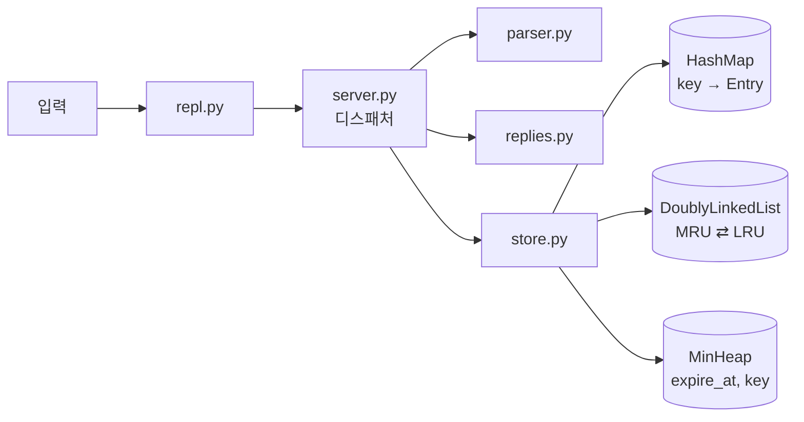

# mini-redis

> In-memory key-value store inspired by Redis, built in Python with hand-rolled hash map, doubly linked list, and min-heap for LRU eviction and TTL expiration
> 해시맵, 이중 연결 리스트, 최소 힙을 직접 구현해 LRU 제거와 TTL 만료를 지원하는 Python 기반 Mini Redis


**No built-in `dict` / `set` / `collections` used.**
키-값 저장, LRU 추적, TTL 관리, 명령어 테이블까지 모두 직접 구현한 자료구조로 동작합니다. 이 제약은 AST 분석 테스트([`tests/test_constraints.py`](tests/test_constraints.py))가 자동으로 검증합니다.

```
mini-redis> CONFIG SET maxmemory 30
OK
mini-redis> SET user:1 "Alice"
OK
mini-redis> SET user:2 "Bob"
OK
mini-redis> SET user:3 "Charlie"      # 33 > 30 → LRU 키(user:1) 자동 제거
OK
mini-redis> GET user:1
(nil)
mini-redis> INFO memory
# Memory
used_memory:22
maxmemory:30
maxmemory_policy:allkeys-lru
evicted_keys:1
```

## 목차

- [빠른 시작](#빠른-시작)
- [명령어](#명령어)
- [아키텍처](#아키텍처)
- [요구사항 구현 매핑](#요구사항-구현-매핑)
- [선택(보너스) 과제 구현 내역](#선택보너스-과제-구현-내역)
- [프로젝트 구조](#프로젝트-구조)
- [테스트](#테스트)
- [문서](#문서)

## 빠른 시작

외부 라이브러리 없이 Python 3.8 이상만 있으면 됩니다. 기준 버전은 3.14(`.python-version`)이고, [uv](https://docs.astral.sh/uv/) 를 쓰면 `uv run python ...` 으로 같은 버전에서 실행됩니다.

```bash
git clone https://github.com/maebsy/mini-redis.git
cd mini-redis
python main.py              # 또는 python -m mini_redis
```

```
Mini Redis 1.0 — 'HELP' 로 명령어 목록, 'exit' 또는 'quit' 로 종료
mini-redis> SET greeting "hello world"
OK
mini-redis> GET greeting
"hello world"
mini-redis> exit
```

준비된 시나리오를 실행해서 결과를 한 번에 볼 수도 있습니다. 입력이 파일이면 프롬프트와 명령을 함께 출력해서 실제 세션과 같은 실행 기록을 만듭니다.

```bash
python main.py < examples/01_basic.txt            # String 명령어
python main.py < examples/02_lru.txt              # LRU 자동 제거
python main.py < examples/03_ttl.txt              # TTL 만료
python main.py < examples/04_errors.txt           # 에러 형식
python main.py < examples/05_bonus_pubsub.txt     # [보너스] Pub/Sub, HISTORY
python main.py < examples/06_debug_structures.txt # 내부 자료구조 관찰
```

## 명령어

### 필수 명령어

| 명령어 | 응답 | 설명 |
| --- | --- | --- |
| `SET key value` | `OK` | 저장. 성공 시 LRU 갱신, 기존 키 덮어쓰기면 TTL 초기화, 한도 초과 시 LRU 제거 |
| `GET key` | `"value"` / `(nil)` | 조회. 반환에 성공했을 때만 LRU 갱신 |
| `DEL key [key ...]` | `(integer) N` | 삭제. 데이터·LRU·TTL 구조에서 함께 제거 |
| `EXISTS key [key ...]` | `(integer) N` | 존재 여부 (LRU 갱신 안 함) |
| `DBSIZE` | `(integer) N` | 전체 키 개수 |
| `KEYS` | `1) "key"` … / `(empty array)` | 전체 키 목록 (패턴 매칭 미지원, `KEYS *`는 허용) |
| `CONFIG SET maxmemory <bytes>` | `OK` | 최대 메모리. `0` = 무제한 |
| `INFO memory` | `used_memory` / `maxmemory` / `evicted_keys` | 메모리 상태 |
| `EXPIRE key seconds` | `(integer) 1` / `0` | 만료 시간 설정. 없는 키는 `0`, 0 이하 값은 즉시 삭제 |
| `TTL key` | `(integer) N` / `-1` / `-2` | 남은 초, 만료 없음(`-1`), 키 없음(`-2`) |

- 명령어는 대소문자를 구분하지 않습니다. 값에 공백이 있으면 `"큰따옴표"` 또는 `'작은따옴표'`로 감쌉니다.

#### KEYS 의 한계

`KEYS`는 **전체 키 목록만** 돌려줍니다. Redis의 글롭 패턴(`user:*`, `h?llo`)은 미션 범위 밖이라 지원하지 않고, Redis 사용 습관을 고려해 `KEYS *`만 같은 뜻으로 받아 줍니다. 순서는 해시맵 버킷 순서라 입력 순서와 다릅니다.

```
mini-redis> SET user:1 "Alice"
OK
mini-redis> SET user:2 "Bob"
OK
mini-redis> SET order:7 "pizza"
OK
mini-redis> KEYS
1) "order:7"
2) "user:1"
3) "user:2"
mini-redis> KEYS *                     # KEYS 와 같음
1) "order:7"
2) "user:1"
3) "user:2"
mini-redis> KEYS user:*                # 패턴은 거절
(error) ERR pattern matching is not supported (use KEYS or KEYS *)
mini-redis> DEBUG RANGEKEYS user: user;   # 접두사 검색이 필요하면: BST 범위 조회 (';' 는 ':' 바로 다음 문자)
1) "user:1"
2) "user:2"
```

`KEYS`는 모든 키를 한 번에 훑고 출력하므로 O(n)입니다. 10만 건에서 수집에 약 60 ms, 출력 문자열을 만드는 데 약 470 ms가 듭니다. 실제 서비스라면 커서로 나눠 읽는 `SCAN`이 필요합니다([`docs/benchmark.md`](docs/benchmark.md#10만-건-규모-병목-분석)).

#### INFO memory 값의 단위

| 필드 | 단위 | 의미 |
| --- | --- | --- |
| `used_memory` | 바이트 | `Σ(len(utf8(key)) + len(utf8(value)))`, 살아있는 키만. 노드·버킷 등 자료구조 오버헤드는 **제외** |
| `maxmemory` | 바이트 | `CONFIG SET maxmemory`로 정한 한도, `0` = 무제한 |
| `evicted_keys` | 개 (누적) | LRU로 제거된 키 수, FLUSHALL 후에도 유지 |

바이트는 글자 수가 아니라 UTF-8 길이입니다. 영문·숫자는 1바이트, 한글은 글자당 3바이트이고, 값을 감싼 따옴표는 세지 않습니다.

```
mini-redis> SET 이름 "김철수"     # 키 2글자 × 3 = 6, 값 3글자 × 3 = 9 → 15 바이트
OK
mini-redis> SET user:1 "Alice"   # 6 + 5 = 11 바이트
OK
mini-redis> INFO memory
# Memory
used_memory:26
maxmemory:0
maxmemory_policy:allkeys-lru
evicted_keys:0
```

INFO의 모든 필드(stats, keyspace 포함)의 단위와 초기화 시점은 [`docs/design.md` 3.7](docs/design.md#37-info-출력값의-단위와-계산), 실제 파이썬 메모리와의 차이(엔트리당 약 575바이트)는 [8.2](docs/design.md#82-used_memory-모델-변경의-영향)에 있습니다.

### 에러 형식

미션이 정한 표준 에러 4종입니다. 문구는 `server.py` 상단의 상수 한 곳에 모여 있습니다.

```
(error) ERR unknown command 'HELLO'
(error) ERR wrong number of arguments for 'GET' command
(error) ERR value is not an integer or out of range
(error) OOM command not allowed when used_memory > 'maxmemory'
```

### 자주 발생하는 에러

모두 실제 실행 결과입니다. 에러가 난 명령은 데이터를 바꾸지 않습니다.

| 입력 | 출력 | 원인 | 해결 |
| --- | --- | --- | --- |
| `HELLO` | `(error) ERR unknown command 'HELLO'` | 없는 명령 | `HELP`로 명령 목록 확인 |
| `GET` | `(error) ERR wrong number of arguments for 'GET' command` | 인자 부족 | `GET key` |
| `SET a` | `(error) ERR wrong number of arguments for 'SET' command` | 값 누락 | `SET a "값"` |
| `TTL a b` | `(error) ERR wrong number of arguments for 'TTL' command` | 인자 초과 | 키는 하나씩: `TTL a` |
| `SET k hello world` | `(error) ERR wrong number of arguments for 'SET' command` | 공백 때문에 값이 두 개로 나뉨 | `SET k "hello world"` |
| `EXPIRE k ten` | `(error) ERR value is not an integer or out of range` | 초가 숫자가 아님 | `EXPIRE k 10` |
| `EXPIRE k 1.5` | `(error) ERR value is not an integer or out of range` | 소수 불가 (정수 초만) | `EXPIRE k 2` |
| `CONFIG SET maxmemory abc` | `(error) ERR value is not an integer or out of range` | 바이트 수가 숫자가 아님 | `CONFIG SET maxmemory 1024` |
| `CONFIG SET maxmemory 5` 후 `SET longkey value` | `(error) OOM command not allowed when used_memory > 'maxmemory'` | 엔트리 하나(7 + 5 = 12바이트)가 한도보다 큼 → 제거해도 들어갈 수 없음 | 한도를 늘리거나 더 짧은 키·값 |
| `SET k "unbalanced` | `(error) ERR Protocol error: unbalanced quotes in request` | 따옴표가 닫히지 않음 | `SET k "balanced"` |
| `KEYS user:*` | `(error) ERR pattern matching is not supported (use KEYS or KEYS *)` | 패턴 미지원 | `KEYS` 또는 `DEBUG RANGEKEYS user: user;` |
| `INFO cpu` | `(error) ERR unsupported INFO section 'cpu' (memory\|stats\|keyspace)` | 없는 섹션 | `INFO memory` |

`1.5`, `+3`, `007`, ` 3`처럼 Redis가 거절하는 정수 표기는 여기서도 모두 거절합니다. 한도를 넘는 SET은 에러가 아니라 **LRU 제거 후 저장**이고, OOM은 엔트리 하나가 한도 자체보다 클 때만 납니다.

### 확장 명령어 (설명·시연용)

| 명령어 | 설명 |
| --- | --- |
| `HELP [command]` | 명령어 목록과 문법 |
| `PING [message]` | 연결 확인 |
| `CONFIG GET maxmemory` | 현재 최대 메모리 |
| `INFO [stats\|keyspace]` | 만료/제거 통계, 키 개수 |
| `PERSIST key` | TTL 제거 |
| `FLUSHALL` | 모든 키 삭제 (설정 유지) |
| `DEBUG HASHMAP` | capacity, 로드 팩터, 리사이즈 횟수, 최장 체인 길이 |
| `DEBUG LRU` | LRU 순서 (MRU → LRU) |
| `DEBUG TTLHEAP` | TTL 최소 힙을 완전 이진 트리로 출력 |
| `DEBUG SORTEDKEYS` / `DEBUG RANGEKEYS lo hi` | BST로 키 정렬 / 범위 조회 |
| `DEBUG SLEEP seconds` | 대기 (TTL 시나리오 시연용) |
| `DEBUG EVICTIONS [count]` | 최근 LRU 제거 기록 (최신순, 최대 16개: 키 · 크기 · 몇 초 전) |

`DEBUG` 명령은 체크리스트 질문("해시맵이 지금 몇 번 확장됐나?", "LRU 순서가 어떻게 바뀌었나?")에 실행 결과로 답하기 위해 만들었습니다.

```
mini-redis> DEBUG TTLHEAP
heap_size:5 live_ttl_keys:5 stale_entries:0
apple (in 10.0s)
├── L: grape (in 20.0s)
│   ├── L: mango (in 50.0s)
│   └── R: lemon (in 40.0s)
└── R: kiwi (in 30.0s)
```

## 아키텍처



핵심은 **하나의 키를 세 자료구조가 서로 다른 관점에서 추적**한다는 점입니다.

| 자료구조 | 질문 | 비용 |
| --- | --- | --- |
| `HashMap` (FNV-1a + 체이닝) | 이 키의 값은? | 평균 O(1) |
| `DoublyLinkedList` | 가장 오래 안 쓴 키는? 방금 쓴 키를 맨 앞으로 | O(1) |
| `MinHeap` | 가장 먼저 만료될 키는? | 확인 O(1), 삭제 O(log n) |

해시맵에 저장된 `Entry`가 자신의 LRU 노드를 가리키고 있어서, GET 한 번이 "해시 조회 O(1) → 노드 이동 O(1)"로 끝납니다. 자세한 설명은 [`docs/design.md`](docs/design.md)에 있습니다.

## 요구사항 구현 매핑

| 요구사항 | 구현 | 검증 |
| --- | --- | --- |
| 이중 연결 리스트 (prev/next/data, 6개 메서드 O(1)) | [`structures/linked_list.py`](mini_redis/structures/linked_list.py) | `tests/test_linked_list.py` |
| 해시맵: 직접 만든 해시 함수 | `fnv1a_64` (FNV-1a 64bit) | 공개 테스트 벡터 비교 |
| 해시맵: 체이닝 (이중 연결 리스트 재사용) | [`structures/hashmap.py`](mini_redis/structures/hashmap.py) | 모든 키를 한 버킷에 몰아넣는 테스트 |
| 해시맵: 로드 팩터 0.75 초과 시 2배 확장 | `HashMap._resize` | `test_resize_when_load_factor_exceeds_075` |
| 최소 힙 (push/pop/peek/size, heapify up/down) | [`structures/min_heap.py`](mini_redis/structures/min_heap.py) | `tests/test_min_heap.py` |
| 만료 여부 선확인, 만료 키는 없는 키처럼 처리 | `Store._lookup` + `expire_due_keys` | `tests/test_store.py::TtlTest` |
| LRU 제거, evicted_keys 누적, 단일 엔트리 초과 OOM | `Store._evict_until_fits` | `tests/test_store.py::LruEvictionTest` |
| Redis 스타일 출력, 표준 에러 | [`replies.py`](mini_redis/replies.py), [`server.py`](mini_redis/server.py) | `tests/test_server.py` |
| REPL (`mini-redis>`, exit/quit) | [`repl.py`](mini_redis/repl.py) | `tests/test_server.py::ReplTest` |
| 따옴표 값 파싱 | [`parser.py`](mini_redis/parser.py) | `tests/test_parser_replies.py` |
| dict/set/collections 미사용, 모듈 분리, docstring | 전체 | `tests/test_constraints.py` |

## 선택(보너스) 과제 구현 내역

과제의 보너스 5개를 모두 구현했습니다. 필수 기능과 구분할 수 있도록 커밋 메시지와 코드 docstring에도 `(보너스)`를 표기했습니다.

| 보너스 과제 | 구현 위치 | 프로젝트 안에서의 활용 | 확인 |
| --- | --- | --- | --- |
| **동적 배열** (append/get/set/remove, 2배 확장) | [`structures/dynamic_array.py`](mini_redis/structures/dynamic_array.py) | 최소 힙의 내부 저장소, `keys()` 반환값 | `tests/test_dynamic_array.py` |
| **스택/큐/덱** + `STACK_QUEUE_DEQUE.md` | [`structures/stack_queue_deque.py`](mini_redis/structures/stack_queue_deque.py), [`docs/STACK_QUEUE_DEQUE.md`](docs/STACK_QUEUE_DEQUE.md) | Pub/Sub 메시지 버퍼(Queue), `HISTORY`·`DEBUG EVICTIONS` 기록(Deque), BST 순회(Stack) | `tests/test_bonus_structures.py` |
| **이진 트리와 순회** (전위/중위/후위/레벨) | [`structures/binary_tree.py`](mini_redis/structures/binary_tree.py) | `DEBUG TTLHEAP`이 힙 배열을 완전 이진 트리로 변환해 출력 | 힙 배열 → 트리 변환 테스트 |
| **이진 탐색 트리** (삽입/탐색/삭제, 중위 순회 정렬) | [`structures/bst.py`](mini_redis/structures/bst.py) | `DEBUG SORTEDKEYS`, `DEBUG RANGEKEYS`, `HELP` 정렬 | 삭제 3가지 경우, 무작위 비교 테스트 |
| **Pub/Sub** (`PUBLISH`, `SUBSCRIBE`) | [`pubsub.py`](mini_redis/pubsub.py) | `UNSUBSCRIBE`, `CLIENT SWITCH`로 여러 구독자 시연 | `examples/05_bonus_pubsub.txt` |

Pub/Sub은 단일 REPL에서 여러 접속자를 흉내 내기 위해 `CLIENT SWITCH <name>`으로 현재 클라이언트를 바꿉니다. 다른 클라이언트로 전환하면 그동안 버퍼에 쌓인 메시지가 출력됩니다.

```
mini-redis> CLIENT SWITCH alice
OK
mini-redis(alice)> SUBSCRIBE news
1) "subscribe"
2) "news"
3) (integer) 1
mini-redis(alice)> CLIENT SWITCH default
OK
mini-redis> PUBLISH news "Mini Redis 1.0 released"
(integer) 1
mini-redis> CLIENT SWITCH alice
OK
1) "message"
2) "news"
3) "Mini Redis 1.0 released"
```

## 프로젝트 구조

```
mini-redis/
├── main.py                     # 실행 진입점: python main.py
├── mini_redis/
│   ├── repl.py                 # 입력/출력 루프
│   ├── server.py               # 명령어 테이블, 인자 검사, 에러 변환
│   ├── parser.py               # 따옴표 지원 토크나이저
│   ├── replies.py              # 응답 타입과 redis-cli 스타일 포맷터
│   ├── store.py                # 저장소 엔진: HashMap + LRU 리스트 + TTL 힙 + 메모리 회계
│   ├── pubsub.py               # [보너스] 발행/구독
│   └── structures/
│       ├── linked_list.py      # 이중 연결 리스트
│       ├── hashmap.py          # FNV-1a 해시 + 체이닝 해시맵
│       ├── min_heap.py         # 최소 힙
│       ├── dynamic_array.py    # [보너스] 동적 배열
│       ├── stack_queue_deque.py# [보너스] 스택/큐/덱
│       ├── binary_tree.py      # [보너스] 이진 트리 + 순회
│       └── bst.py              # [보너스] 이진 탐색 트리
├── tests/                      # unittest 106개
├── examples/                   # 시나리오 입력 파일
├── scripts/
│   ├── benchmark.py            # 1천 ~ 10만 건 처리량 측정
│   ├── profile_100k.py         # 10만 건에서 단계별 시간 (리사이즈, KEYS 렌더링, 대량 만료)
│   ├── memory_overhead.py      # used_memory 와 실제 메모리 비교, 메모리 모델별 과제 예시 재생
│   ├── hash_distribution.py    # FNV-1a 버킷 분포 (이론값 비교, 나쁜 해시 비교군)
│   ├── ttl_heap_stats.py       # TTL 힙 stale 누적과 재구성 빈도
│   └── ci_local.py             # CI 워크플로를 로컬에서 실행
└── docs/
    ├── design.md               # 설계 문서
    ├── checklist.md            # 체크리스트 답변서
    ├── benchmark.md            # 성능 측정 결과
    ├── feedback.md             # 동료 평가 피드백 반영 내역
    ├── STACK_QUEUE_DEQUE.md    # [보너스] 스택/큐/덱 정리
    └── presentation.html       # 동료 평가 발표 슬라이드
```

## 테스트

```bash
python -m unittest discover -s tests -t . -v
```

| 테스트 파일 | 검증 내용 |
| --- | --- |
| `test_linked_list.py` | 6개 메서드, 중간/처음/끝 삭제, 역방향 링크 일관성 |
| `test_hashmap.py` | FNV-1a 테스트 벡터, 강제 충돌, 0.75 확장 시점, 무작위 3,000회 참조 비교 |
| `test_min_heap.py` | 힙 속성 유지, TTL 튜플 순서, 무작위 힙 정렬 |
| `test_store.py` | LRU 제거, OOM, TTL 13개 규칙, 무작위 5,000회 연산 후 불변식 검사 |
| `test_server.py` | 명령어 출력 형식, 표준 에러, 과제 예시 재현, Pub/Sub, REPL |
| `test_bonus_structures.py` | 스택/큐/덱, 트리 순회, BST 삭제 3가지 경우 |
| `test_constraints.py` | dict/set/collections 미사용, 내장 `hash()` 미사용, docstring |

TTL 테스트는 가짜 시계(`tests/helpers.py::FakeClock`)를 주입해서 실제로 기다리지 않고 시간을 흘려보냅니다. 테스트와 예시 시나리오는 [`.github/workflows/tests.yml`](.github/workflows/tests.yml) 에 Python 3.8 · 3.10 · 3.12 · 3.13 · 3.14 로 정의되어 있고, `uv run scripts/ci_local.py` 로 같은 단계를 내 컴퓨터에서 Python 버전별로 그대로 실행할 수 있습니다 (커밋된 상태 기준, Linux·macOS).

## 문서

| 문서 | 내용 |
| --- | --- |
| [`docs/design.md`](docs/design.md) | 계층 구조, 자료구조별 구현과 측정(해시 분포, 리해시 비용, 힙 재구성), 세 구조의 동기화 순서, 제거 정책 비교, 동시성 한계, LFU 전환, used_memory 모델 |
| [`docs/checklist.md`](docs/checklist.md) | 미션 체크리스트 전 항목에 대한 근거와 답변 |
| [`docs/benchmark.md`](docs/benchmark.md) | 1천 ~ 10만 건 성능 측정, 10만 건 병목 분석과 샤딩 · 병렬화 · I/O 대책 |
| [`docs/feedback.md`](docs/feedback.md) | 동료 평가 17개 항목의 부족한 점 · 보완 반영 체크리스트 |
| [`docs/STACK_QUEUE_DEQUE.md`](docs/STACK_QUEUE_DEQUE.md) | [보너스] 스택/큐/덱 개념과 활용처 |
| [`docs/presentation.html`](docs/presentation.html) | 동료 평가 발표 슬라이드 79장 (부록 A6 에 피드백 반영 내역) (브라우저로 열기, ← → 넘기기 · N 발표자 노트 · 인쇄하면 PDF) |

## 설계 원칙과 범위

- 과제 제약에 따라 네트워크 통신, 파일 영속성, List/Set/Sorted Set 자료형, 동시성 처리는 구현하지 않았습니다.
- `list`는 고정 길이 배열(버킷 테이블, 동적 배열 저장소)과 토큰 배열 용도로만 사용하고, Key-Value 저장·조회에는 쓰지 않습니다.
- TTL은 `time.monotonic` 기준이라 시스템 시간을 바꿔도 영향을 받지 않습니다.
