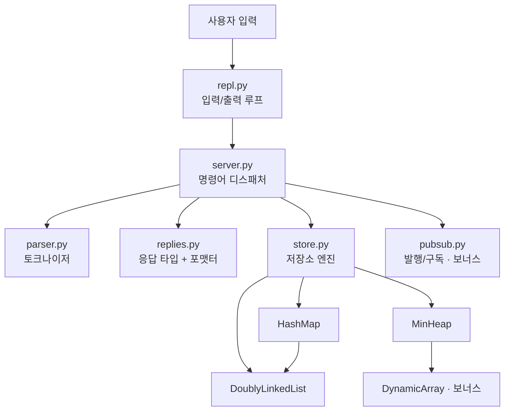

# 설계 문서

Mini Redis의 구조, 자료구조별 구현 방식, 명령어 처리 흐름, 설계 결정을 정리한 문서입니다.
README가 "무엇을 할 수 있는가"를 다룬다면, 이 문서는 "어떻게, 왜 그렇게 만들었는가"를 다룹니다.

- [1. 계층 구조](#1-계층-구조)
- [2. 자료구조](#2-자료구조)
- [3. 저장소 엔진 (Store)](#3-저장소-엔진-store)
- [4. 명령어 처리 흐름](#4-명령어-처리-흐름)
- [5. 에러 처리](#5-에러-처리)
- [6. 설계 결정 기록](#6-설계-결정-기록)
- [7. 한계와 개선 방향](#7-한계와-개선-방향)

---

## 1. 계층 구조



| 계층 | 모듈 | 책임 | 모르는 것 |
| --- | --- | --- | --- |
| 입출력 | `repl.py` | 프롬프트, 입력 읽기, 종료 처리 | 명령어 의미 |
| 해석 | `parser.py` | 한 줄 → 토큰 배열 (따옴표/이스케이프) | 명령어 종류 |
| 디스패치 | `server.py` | 명령어 조회, 인자 개수 검사, 에러 변환 | 자료구조 내부 |
| 표현 | `replies.py` | 응답 타입 → `(integer) 1` 같은 출력 문자열 | 데이터 출처 |
| 데이터 | `store.py` | 키-값, LRU, TTL, 메모리 회계 | 명령어 문법, 출력 형식 |
| 자료구조 | `structures/*` | 범용 자료구조 | Redis 자체 |

계층을 나눈 이유는 **바뀌는 이유가 다른 코드를 분리**하기 위해서입니다. 예를 들어 출력 형식을 바꾸면 `replies.py`만, 제거 정책을 LRU에서 LFU로 바꾸면 `store.py`만 수정하면 됩니다. `Store`는 문자열 출력을 전혀 모르기 때문에 테스트에서도 파이썬 값으로 바로 검증할 수 있습니다(`tests/test_store.py`).

## 2. 자료구조

모든 자료구조는 `mini_redis/structures/` 아래 독립 모듈로 분리되어 있습니다.

### 2.1 이중 연결 리스트 — `linked_list.py`

```
 _head(센티널) ⇄ [A] ⇄ [B] ⇄ [C] ⇄ _tail(센티널)
   front(MRU) ───────────────────▶ back(LRU)
```

- **노드 구조**: `Node(prev, next, data)`. `__slots__`로 세 필드만 허용합니다.
- **센티널 노드**: 양 끝에 데이터 없는 노드를 두어, 실제 노드는 항상 앞뒤에 이웃이 있습니다. 그래서 "첫 노드 삭제", "마지막 노드 삭제", "중간 노드 삭제"를 `_unlink()` 하나로 처리합니다. `if node is head` 같은 분기가 없어 실수할 여지가 줄어듭니다.
- **O(1) 보장**: 모든 연산은 포인터 2~4개만 바꿉니다.

| 메서드 | 동작 | 바뀌는 포인터 |
| --- | --- | --- |
| `insert_front(data)` | head 뒤에 연결 | 4개 |
| `insert_back(data)` | tail 앞에 연결 | 4개 |
| `remove_front()` / `remove_back()` | head 다음 / tail 이전 노드 제거 | 2개 |
| `remove_node(node)` | 노드의 이웃끼리 직접 연결 | 2개 |
| `move_to_front(node)` | `_unlink` + head 뒤에 연결 (노드 객체 재사용) | 6개 |

`insert_*`가 **노드 객체를 반환**하는 것이 핵심입니다. 호출한 쪽이 노드를 보관하고 있으면 나중에 리스트를 탐색하지 않고 바로 `remove_node` / `move_to_front`를 호출할 수 있습니다. LRU와 Pub/Sub 구독 해제가 이 방식을 사용합니다.

### 2.2 해시맵 — `hashmap.py`

#### 해시 함수: FNV-1a 64bit

```python
h = 0xCBF29CE484222325                 # offset basis
for byte in key.encode("utf-8"):       # 1) 문자열 → UTF-8 바이트
    h ^= byte                          # 2) 바이트를 하위 비트에 섞고
    h = (h * 0x100000001B3) & MASK_64  # 3) 소수를 곱해 전체 비트로 퍼뜨린 뒤 64비트로 자른다
index = h & (capacity - 1)             # 4) 버킷 인덱스 (capacity = 2^k)
```

| 단계 | 이유 |
| --- | --- |
| UTF-8 인코딩 | 한글 키(`이름`)도 바이트 단위로 같은 방식으로 처리 |
| XOR 먼저, 곱셈 나중 (FNV-1a) | 마지막 바이트까지 곱셈으로 확산되어 비슷한 키(`user:1`, `user:2`)도 다른 위치로 흩어짐 |
| `& MASK_64` | 파이썬 int는 무한 정밀도라 직접 잘라줘야 64비트 해시가 됨 |
| `& (capacity - 1)` | capacity가 2의 거듭제곱이면 `% capacity`와 같은 결과를 비트 연산으로 빠르게 얻음 |

내장 `hash()`를 쓰지 않은 이유는 두 가지입니다. 과제 요구사항이 "해시 함수 직접 설계"이고, 내장 `hash()`는 실행할 때마다 시드가 바뀌어(`PYTHONHASHSEED`) 버킷 배치를 재현할 수 없기 때문입니다. FNV-1a는 공개 테스트 벡터로 정확성을 검증했습니다(`tests/test_hashmap.py::test_known_vectors`).

#### 충돌 해결: 체이닝

```
buckets (capacity = 8)
[0] None
[1] ─▶ DLL: (user:3, …) ⇄ (cart:9, …)     ← 같은 인덱스로 모인 키들
[2] None
[3] ─▶ DLL: (user:1, …)
...
```

- 버킷은 처음엔 `None`이고, 첫 키가 들어올 때 `DoublyLinkedList`를 만듭니다(지연 생성). 비면 다시 `None`으로 돌립니다.
- 같은 인덱스에 모인 엔트리는 체인 뒤에 붙고, 조회는 **해당 버킷의 체인만** 선형 탐색합니다.
- 버킷 내부 구조로 이중 연결 리스트를 고른 이유: 과제 권장사항이고, 이미 만든 O(1) 삽입/삭제 리스트를 재사용할 수 있으며, 동적 배열과 달리 중간 삭제 때 원소를 당길 필요가 없습니다.

#### 리사이즈: 로드 팩터 0.75 초과 시 2배

```
put() 후 size / capacity > 0.75 ?
   └─ 예 → _resize(capacity * 2)
            1) 크기 2배의 빈 버킷 테이블 생성
            2) 기존 모든 엔트리를 순회
            3) 새 capacity 기준으로 인덱스를 다시 계산(rehash)해서 새 체인에 삽입
```

capacity가 바뀌면 `h & (capacity - 1)`에서 사용하는 비트 수가 달라지므로, 단순 복사가 아니라 **모든 키의 인덱스를 다시 계산**해야 합니다. 확장 한 번은 O(n)이지만 2배씩 늘리므로 put의 분할 상환(amortized) 비용은 O(1)입니다. `DEBUG HASHMAP` 명령으로 capacity, 로드 팩터, 리사이즈 횟수, 최장 체인 길이를 실시간으로 볼 수 있습니다.

### 2.3 최소 힙 — `min_heap.py`

```
배열:  [ (10,a) (20,g) (30,k) (50,m) (40,l) ]
인덱스:    0      1      2      3      4

트리:         (10,a)              부모(i)  = (i-1)//2
            /        \            왼쪽(i)  = 2i+1
        (20,g)      (30,k)        오른쪽(i) = 2i+2
        /    \
    (50,m) (40,l)
```

- 완전 이진 트리를 배열(`DynamicArray`)에 레벨 순서로 저장합니다. 포인터 없이 인덱스 계산만으로 부모/자식을 찾습니다.
- `push`: 맨 끝에 넣고 부모보다 작으면 교환하며 올림(`_heapify_up`) → O(log n)
- `pop`: 루트를 꺼내고 마지막 원소를 루트로 옮긴 뒤 더 작은 자식과 교환하며 내림(`_heapify_down`) → O(log n)
- `peek`: 루트 확인 → O(1)
- TTL에서는 `(expire_at, key)` 튜플을 저장합니다. 튜플은 첫 원소부터 비교되므로 **가장 먼저 만료될 키가 항상 루트**에 있습니다. `DEBUG TTLHEAP`이 이 배열을 이진 트리로 그려 보여줍니다.

## 3. 저장소 엔진 (Store)

### 3.1 하나의 키를 세 구조가 추적한다

```
             HashMap                        DoublyLinkedList (LRU)
  ┌────────────────────────────┐       front(MRU)              back(LRU)
  │ "user:2" → Entry ──────────┼──┐     ┌──────┐   ┌──────┐   ┌──────┐
  │            value  "Bob"    │  └────▶│user:2│ ⇄ │user:3│ ⇄ │user:1│ ← 다음 제거 대상
  │            size   9        │        └──────┘   └──────┘   └──────┘
  │            lru_node ───────┘
  │            expire_at 105.0 │       MinHeap (TTL)
  └────────────────────────────┘       루트 = (105.0, "user:2")
```

`Entry.lru_node`가 해시맵과 리스트를 잇는 다리입니다. GET이 성공하면 `해시맵 조회(O(1)) → entry.lru_node → move_to_front(O(1))` 순으로 LRU를 갱신합니다.

### 3.2 불변식

모든 명령이 끝난 뒤 다음이 항상 성립합니다. `tests/test_store.py::ConsistencyTest`가 무작위 5,000회 연산 후마다 검사합니다.

1. `used_memory == Σ(len(utf8(key)) + len(utf8(value)))` (살아있는 엔트리 기준)
2. `maxmemory > 0`이면 `used_memory <= maxmemory`
3. 해시맵의 키 집합 == LRU 리스트의 키 집합
4. TTL 힙에는 stale 항목이 남을 수 있지만, 꺼낼 때 검증하므로 결과에 영향이 없음

### 3.3 SET 흐름과 LRU 제거

```
SET key value
 1) size = len(utf8(key)) + len(utf8(value))
 2) maxmemory > 0 이고 size > maxmemory → (error) OOM, 저장하지 않음
 3) _lookup(key)  (만료됐으면 여기서 삭제됨)
    ├─ 기존 키: used_memory += size - old_size, 값 교체, TTL 초기화, move_to_front
    └─ 새 키  : insert_front(key) → Entry 생성 → HashMap.put, used_memory += size
 4) _evict_until_fits():
      while maxmemory > 0 and used_memory > maxmemory:
          victim = LRU 리스트 맨 뒤 (가장 오래 사용 안 한 키)
          HashMap.remove / remove_node / used_memory -= victim.size
          evicted_keys += 1
```

방금 SET한 키는 리스트 맨 앞(MRU)에 있고 크기가 maxmemory 이하로 보장되므로, 제거 루프가 그 키까지 지우는 일은 없습니다.

### 3.4 GET 흐름

```
GET key
 1) entry = HashMap.get(key)                       O(1)
 2) entry 없음 → (nil)
 3) expire_at <= now → 데이터/LRU에서 삭제, used_memory 감소, expired_keys += 1 → (nil)
    ※ 이때 LRU 갱신은 하지 않는다
 4) move_to_front(entry.lru_node)                  O(1)  ← 반환 성공 시에만
 5) "value" 반환
```

### 3.5 TTL: lazy + active 만료

| 방식 | 언제 | 어떻게 | 왜 필요한가 |
| --- | --- | --- | --- |
| Lazy | 키를 건드리는 명령(GET, EXISTS, TTL, SET…)마다 | `_lookup()`이 `expire_at <= now`면 삭제 후 없는 키로 처리 | 만료된 값을 절대 반환하지 않음 |
| Active | **모든 명령 실행 직전** | 힙 루트가 만료됐으면 pop → 검증 → 삭제, 루트가 미래면 즉시 중단 | 아무도 조회하지 않는 만료 키가 메모리를 계속 차지하는 것을 방지, DBSIZE/KEYS 정확도 |

**Lazy deletion (힙에서 지우지 않기)**: DEL이나 SET 덮어쓰기로 TTL이 사라져도 힙의 `(expire_at, key)`는 그대로 둡니다. 힙 중간 원소 삭제는 위치를 찾는 데 O(n)이 들기 때문입니다. 대신 힙에서 꺼낼 때 `entry is None or entry.expire_at != expire_at`이면 버립니다(stale). stale 항목이 살아있는 TTL 키의 2배를 넘으면 힙을 재구성해 메모리 누적을 막습니다(`_maybe_compact_ttl_heap`).

### 3.6 시계 주입

`Store(clock=time.monotonic)`처럼 시계를 주입받습니다.

- `time.monotonic`: 시스템 시간을 바꿔도 거꾸로 가지 않아 TTL 계산이 안전합니다.
- 테스트에서는 `FakeClock`을 넣어 `advance(3)`으로 3초를 즉시 흘려보냅니다. 실제로 기다리지 않으므로 TTL 테스트가 빠르고 결과가 항상 같습니다.

## 4. 명령어 처리 흐름

```
"SET user:1 \"Alice Kim\""
   │ tokenize()                   → ["SET", "user:1", "Alice Kim"]
   │ commands.get("SET")          → CommandSpec(min=2, max=2, handler=_cmd_set)   ← 직접 만든 HashMap
   │ 인자 개수 검사               → 실패 시 ERR wrong number of arguments
   │ store.expire_due_keys()      → active expiration
   │ handler(typed, args)         → Store.set(...)  → R.OK
   │ render(R.OK)                 → "OK"
   ▼
 출력
```

명령어 이름은 `upper()`로 정규화해서 조회하므로 대소문자를 구분하지 않습니다. 명령어 테이블(`HashMap[이름 → CommandSpec]`)도 직접 만든 해시맵을 사용합니다.

## 5. 에러 처리

| 상황 | 출력 | 발생 위치 |
| --- | --- | --- |
| 없는 명령 | `(error) ERR unknown command 'HELLO'` | `Server.execute` |
| 인자 개수 | `(error) ERR wrong number of arguments for 'GET' command` | `Server.execute`(arity), 서브커맨드는 핸들러 |
| 정수 파싱 | `(error) ERR value is not an integer or out of range` | `parse_int` |
| 메모리 초과 | `(error) OOM command not allowed when used_memory > 'maxmemory'` | `Store.set` → `OutOfMemoryError` |
| 따옴표 짝 | `(error) ERR Protocol error: unbalanced quotes in request` | `tokenize` → `ParseError` |

핸들러는 `CommandError`를 던지기만 하고, `(error) ...` 형식 변환은 `Server.execute` 한 곳에서 합니다. 에러 문구 형식이 한 군데에 모여 있어 일관성이 보장됩니다.

`parse_int`는 Redis처럼 엄격합니다. `1.5`, ` 3`, `+3`, `007`은 모두 정수로 인정하지 않습니다.

## 6. 설계 결정 기록

| 결정 | 선택 | 대안 | 이유 |
| --- | --- | --- | --- |
| LRU 리스트 방향 | front=MRU, back=LRU | 반대 | "최근 사용 → 앞으로", "제거 → 뒤에서"가 직관적 |
| EXISTS의 LRU 갱신 | 갱신 안 함 | 갱신 | 과제 명세는 "SET/GET 성공 시"만 갱신. 실제 Redis도 EXISTS는 `LOOKUP_NOTOUCH` |
| CONFIG SET maxmemory 축소 시 | 즉시 제거 | 다음 SET까지 대기 | "명령 후 항상 used ≤ max" 불변식 유지 |
| 큰 값으로 덮어쓰다 OOM | 기존 값 유지 | 기존 키 삭제 | 실패한 명령이 데이터를 바꾸지 않도록 (원자성) |
| TTL 반환값 | 남은 초 올림 | 반올림/내림 | 0.3초 남은 키가 `0`으로 보이면 이미 없는 키로 오해 |
| TTL 힙 삭제 | lazy deletion | 인덱스 맵 + 중간 삭제 | 힙 중간 삭제 O(n) 회피, 구현 단순 |
| 시계 | `time.monotonic` 주입 | `time.time` 직접 호출 | 시스템 시간 변경에 안전, 테스트 결정성 |
| DEL / EXISTS 다중 키 | 지원 | 단일 키만 | 실제 Redis 호환, 단일 키 동작은 명세와 동일 |
| KEYS 패턴 | `KEYS`, `KEYS *`만 허용 | 글롭 매칭 | 명세상 패턴 매칭 미구현, `*`는 Redis 사용자 습관 배려 |

## 7. 한계와 개선 방향

| 항목 | 현재 | 개선 |
| --- | --- | --- |
| 리사이즈 | 한 번에 전체 재해싱 (O(n) 순간 지연) | Redis처럼 두 테이블을 두고 명령마다 일부 버킷씩 옮기는 점진적 리해싱 |
| KEYS | 전체 순회 O(n), 대량 데이터에서 블로킹 | 커서 기반 `SCAN` |
| LRU | 정확한 LRU (모든 접근마다 리스트 이동) | Redis처럼 샘플링 기반 근사 LRU로 포인터 오버헤드 감소 |
| BST | 비균형 (정렬된 입력에 O(n)) | AVL / Red-Black 트리 |
| 영속성·네트워크 | 미구현 (과제 범위 밖) | RDB 스냅샷, RESP 프로토콜 서버 |

성능 측정 결과와 분석은 [`benchmark.md`](benchmark.md)에 있습니다.
