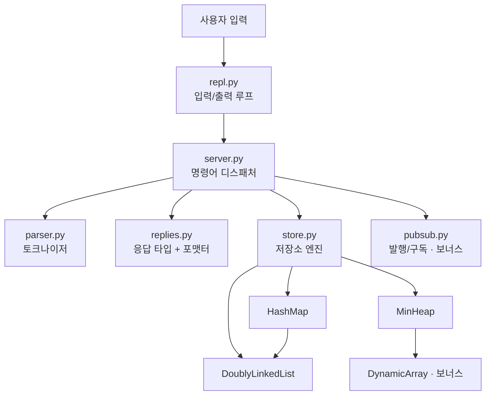
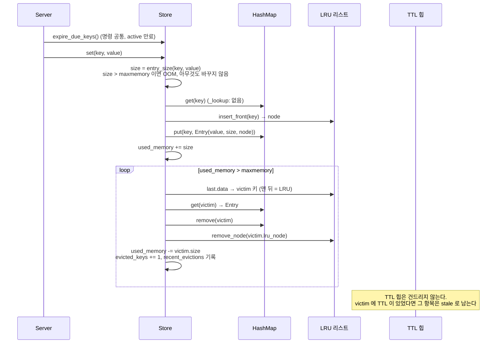
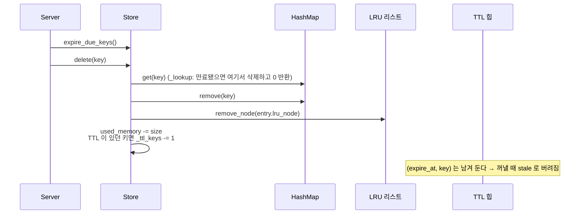
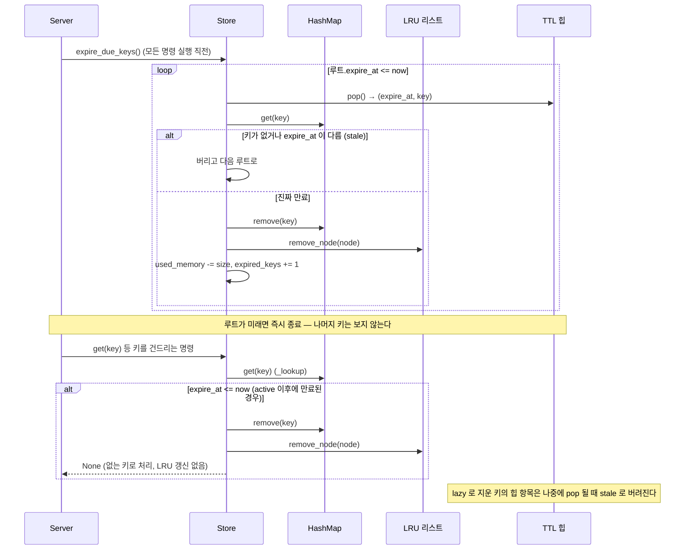

# 설계 문서

Mini Redis의 구조, 자료구조별 구현 방식, 명령어 처리 흐름, 설계 결정을 정리한 문서입니다.
README가 "무엇을 할 수 있는가"를 다룬다면, 이 문서는 "어떻게, 왜 그렇게 만들었는가"를 다룹니다.

- [1. 계층 구조](#1-계층-구조)
- [2. 자료구조](#2-자료구조)
- [3. 저장소 엔진 (Store)](#3-저장소-엔진-store)
- [4. 명령어 처리 흐름](#4-명령어-처리-흐름)
- [5. 에러 처리](#5-에러-처리)
- [6. 설계 결정 기록](#6-설계-결정-기록)
- [7. 한계와 개선 방향](#7-한계와-개선-방향) — [동시성에서의 O(1) 보장 한계](#동시성에서의-o1-보장-한계)
- [8. 확장 설계](#8-확장-설계) — [8.1 LRU → LFU 전환](#81-lru--lfu-전환) · [8.2 used_memory 모델 변경의 영향](#82-used_memory-모델-변경의-영향)

자주 찾는 절: [해시 분포 실험](#해시-분포-실험) · [리해시 비용과 대안](#리해시-비용과-대안) · [stale 항목과 재구성 빈도](#stale-항목과-재구성-빈도) · [세 구조의 동기화 순서](#세-구조의-동기화-순서) · [제거 정책 비교](#제거-정책-비교) · [GET 과 expire_due_keys 의 호출 시점](#get-과-expire_due_keys-의-호출-시점) · [TTL 예외 케이스](#예외-케이스) · [3.7 INFO 단위](#37-info-출력값의-단위와-계산) · [3.8 DEBUG EVICTIONS](#38-제거-기록-관찰-debug-evictions)

---

## 1. 계층 구조



| 계층 | 모듈 | 책임 | 모르는 것 |
| --- | --- | --- | --- |
| 입출력 | `repl.py` | 프롬프트, 입력 읽기, 종료 처리 | 명령어 의미 |
| 해석 | `parser.py` | 한 줄 → 토큰 배열 (따옴표/이스케이프) | 명령어 종류 |
| 디스패치 | `server.py` | 명령어 조회, 인자 개수 검사, 에러 변환 | 자료구조 내부 |
| 표현 | `replies.py` | 응답 타입 → `(integer) 1` 같은 출력 문자열 | 데이터 출처 |
| 데이터 | `store.py` | 키-값, LRU, TTL, 메모리 회계 | 명령어 문법, 출력 형식 |
| 자료구조 | `structures/*` | 범용 자료구조 | Redis 자체 |

계층을 나눈 이유는 **바뀌는 이유가 다른 코드를 분리**하기 위해서입니다. 예를 들어 출력 형식을 바꾸면 `replies.py`만, 제거 정책을 LRU에서 LFU로 바꾸면 `store.py`만 수정하면 됩니다. `Store`는 문자열 출력을 전혀 모르기 때문에 테스트에서도 파이썬 값으로 바로 검증할 수 있습니다(`tests/test_store.py`).

## 2. 자료구조

모든 자료구조는 `mini_redis/structures/` 아래 독립 모듈로 분리되어 있습니다.

### 2.1 이중 연결 리스트 — `linked_list.py`

```
 _head(센티널) ⇄ [A] ⇄ [B] ⇄ [C] ⇄ _tail(센티널)
   front(MRU) ───────────────────▶ back(LRU)
```

- **노드 구조**: `Node(prev, next, data)`. `__slots__`로 세 필드만 허용합니다.
- **센티널 노드**: 양 끝에 데이터 없는 노드를 두어, 실제 노드는 항상 앞뒤에 이웃이 있습니다. 그래서 "첫 노드 삭제", "마지막 노드 삭제", "중간 노드 삭제"를 `_unlink()` 하나로 처리합니다. `if node is head` 같은 분기가 없어 실수할 여지가 줄어듭니다.
- **O(1) 보장**: 모든 연산은 정해진 개수의 포인터만 바꿉니다. 리스트 길이와 무관합니다.

| 메서드 | 동작 | 바뀌는 포인터 |
| --- | --- | --- |
| `insert_front(data)` | head 뒤에 연결 (`_link_after`) | 4개 |
| `insert_back(data)` | tail 앞에 연결 (`_link_after`) | 4개 |
| `remove_front()` / `remove_back()` | head 다음 / tail 이전 노드 제거 (`_unlink`) | 이웃 2개 + 떼어낸 노드 정리 2개 |
| `remove_node(node)` | 노드의 이웃끼리 직접 연결 (`_unlink`) | 이웃 2개 + 떼어낸 노드 정리 2개 |
| `move_to_front(node)` | `_unlink` + head 뒤에 연결 (노드 객체 재사용) | 떼기 4개 + 연결 4개 |

"떼어낸 노드 정리"는 `_unlink`가 떼어낸 노드의 `prev`/`next`를 `None`으로 지우는 두 줄입니다. 이미 제거된 노드를 다시 지우려 할 때 이를 감지하는 용도입니다. 같은 개수가 `linked_list.py`의 각 메서드 docstring에도 적혀 있습니다(예: `insert_front` → `O(1) — 포인터 4개 연결`). 어느 메서드에도 반복문이 없으므로, 노드가 10개든 10만 개든 바뀌는 포인터 수는 같습니다.

`insert_*`가 **노드 객체를 반환**하는 것이 핵심입니다. 호출한 쪽이 노드를 보관하고 있으면 나중에 리스트를 탐색하지 않고 바로 `remove_node` / `move_to_front`를 호출할 수 있습니다. LRU와 Pub/Sub 구독 해제가 이 방식을 사용합니다.

### 2.2 해시맵 — `hashmap.py`

#### 해시 함수: FNV-1a 64bit

```python
h = 0xCBF29CE484222325                 # offset basis
for byte in key.encode("utf-8"):       # 1) 문자열 → UTF-8 바이트
    h ^= byte                          # 2) 바이트를 하위 비트에 섞고
    h = (h * 0x100000001B3) & MASK_64  # 3) 소수를 곱해 전체 비트로 퍼뜨린 뒤 64비트로 자른다
index = h & (capacity - 1)             # 4) 버킷 인덱스 (capacity = 2^k)
```

| 단계 | 이유 |
| --- | --- |
| UTF-8 인코딩 | 한글 키(`이름`)도 바이트 단위로 같은 방식으로 처리 |
| XOR 먼저, 곱셈 나중 (FNV-1a) | 마지막 바이트까지 곱셈으로 확산되어 비슷한 키(`user:1`, `user:2`)도 다른 위치로 흩어짐 |
| `& MASK_64` | 파이썬 int는 무한 정밀도라 직접 잘라줘야 64비트 해시가 됨 |
| `& (capacity - 1)` | capacity가 2의 거듭제곱이면 `% capacity`와 같은 결과를 비트 연산으로 빠르게 얻음 |

내장 `hash()`를 쓰지 않은 이유는 두 가지입니다. 과제 요구사항이 "해시 함수 직접 설계"이고, 내장 `hash()`는 실행할 때마다 시드가 바뀌어(`PYTHONHASHSEED`) 버킷 배치를 재현할 수 없기 때문입니다. FNV-1a는 공개 테스트 벡터로 정확성을 검증했습니다(`tests/test_hashmap.py::test_known_vectors`).

#### 해시 분포 실험

테스트 벡터는 "구현이 표준과 같은가"만 보여 줍니다. "키가 버킷에 고르게 퍼지는가"는 실제 키를 넣고 버킷 배열을 직접 세어 확인했습니다.

```bash
python3 scripts/hash_distribution.py     # 1천 / 1만 / 10만 건, 키 집합 4종 + 나쁜 해시 비교군
```

키를 실제 `HashMap`에 넣어 리사이즈 정책이 capacity를 정하게 한 뒤 버킷마다 체인 길이를 셉니다. 해시가 이상적(균등)이라면 버킷당 키 수는 평균 α(로드 팩터)인 포아송 분포를 따르므로, 다음 이론값과 비교할 수 있습니다.

- 빈 버킷 비율 ≈ e^(−α)
- 사용 중인 버킷의 평균 체인 길이 ≈ α / (1 − e^(−α))
- χ²/df = Σ(c − α)² / α ÷ (capacity − 1) ≈ 1.0 (1보다 크게 벗어나면 뭉쳐 있다는 뜻)

| 키 집합 | N | capacity | α | 빈 버킷 (측정 / 이론) | 평균 체인 (측정 / 이론) | 최장 체인 | χ²/df |
| --- | --- | --- | --- | --- | --- | --- | --- |
| `user:{i}` (연속 번호) | 10,000 | 16,384 | 0.61 | 0.579 / 0.543 | 1.45 / 1.34 | 7 | 1.21 |
| `{i}` (숫자만) | 10,000 | 16,384 | 0.61 | 0.556 / 0.543 | 1.38 / 1.34 | 5 | 1.08 |
| 무작위 8자 `[a-z0-9]` | 10,000 | 16,384 | 0.61 | 0.540 / 0.543 | 1.33 / 1.34 | 5 | 0.98 |
| `사용자:{i}` (한글) | 10,000 | 16,384 | 0.61 | 0.562 / 0.543 | 1.39 / 1.34 | 5 | 1.17 |
| `user:{i}` | 100,000 | 262,144 | 0.38 | 0.699 / 0.683 | 1.27 / 1.20 | 5 | 1.11 |
| `{i}` | 100,000 | 262,144 | 0.38 | 0.691 / 0.683 | 1.23 / 1.20 | 5 | 1.06 |
| 무작위 8자 | 100,000 | 262,144 | 0.38 | 0.683 / 0.683 | 1.20 / 1.20 | 6 | 1.00 |
| `사용자:{i}` | 100,000 | 262,144 | 0.38 | 0.683 / 0.683 | 1.21 / 1.20 | 5 | 1.00 |
| **비교군**: 바이트 합 해시, `user:{i}` | 10,000 | 16,384 | 0.61 | 0.994 / 0.543 | 109.9 / 1.34 | 615 | 403.8 |
| **비교군**: 바이트 합 해시, `user:{i}` | 100,000 | 262,144 | 0.38 | 0.999 / 0.683 | 735.3 / 1.20 | 5,520 | 3,611.8 |

<sub>Python 3.14.4 / Linux, 2026-11-09. `random.Random(42)`로 고정해 다시 실행해도 같은 표가 나옵니다.</sub>

- FNV-1a는 모든 키 집합에서 빈 버킷 비율과 평균 체인 길이가 이론값과 몇 % 안쪽으로 맞고, χ²/df가 0.98~1.21입니다. 무작위 문자열(가장 이상적인 입력)과 `user:0`처럼 한 글자씩만 다른 연속 키의 결과가 거의 같습니다. 즉 **비슷한 키를 넣어도 균등 분포에 가깝게 흩어집니다**.
- 바이트 합 해시는 `user:1`과 `user:10`처럼 글자 합이 비슷한 키가 좁은 범위로 몰려, 10만 건에서 버킷의 99.9%가 비고 한 체인에 5,520개가 쌓입니다. 이러면 조회가 사실상 O(n)이 됩니다. 해시 함수의 품질이 곧 해시맵의 O(1)을 지키는 조건이라는 것을 보여 주는 비교군입니다.

#### 충돌 해결: 체이닝

```
buckets (capacity = 8)
[0] None
[1] ─▶ DLL: (user:3, …) ⇄ (cart:9, …)     ← 같은 인덱스로 모인 키들
[2] None
[3] ─▶ DLL: (user:1, …)
...
```

- 버킷은 처음엔 `None`이고, 첫 키가 들어올 때 `DoublyLinkedList`를 만듭니다(지연 생성). 비면 다시 `None`으로 돌립니다.
- 같은 인덱스에 모인 엔트리는 체인 뒤에 붙고, 조회는 **해당 버킷의 체인만** 선형 탐색합니다.
- 버킷 내부 구조로 이중 연결 리스트를 고른 이유: 과제 권장사항이고, 이미 만든 O(1) 삽입/삭제 리스트를 재사용할 수 있으며, 동적 배열과 달리 중간 삭제 때 원소를 당길 필요가 없습니다.

#### 체인 노드의 생성·해제 비용과 재사용

| 시점 | 새로 만드는 객체 | 해제되는 객체 |
| --- | --- | --- |
| `put` (새 키) | 해시맵 `_Entry(key, value)` 1개 + 체인 `Node` 1개. 빈 버킷이면 `DoublyLinkedList` 1개(센티널 `Node` 2개 포함) | 없음 |
| `put` (기존 키) | 없음. `node.data.value`만 교체 | 이전 값 (참조가 없어지면) |
| `remove` | 없음 | 체인 `Node` + `_Entry`. 버킷이 비면 그 `DoublyLinkedList`도 (`None`으로 되돌림) |
| `_resize` | **체인 `Node`와 버킷 리스트는 새로 만듦**. `_Entry` 객체는 그대로 옮겨 재사용 | 옛 버킷 배열과 옛 체인 `Node`·리스트 전부 |

`_resize`는 옛 체인을 돌며 `target.insert_back(entry)`를 호출하므로, 키-값 묶음(`_Entry`)은 재사용하지만 그것을 감싸는 체인 노드는 다시 만듭니다. 10만 건까지 리사이즈가 15번 일어나므로 체인 노드는 엔트리당 평균 약 2번 생성·폐기됩니다(2배 확장의 등비급수: n + n/2 + n/4 + … < 2n).

해제는 따로 하지 않습니다. CPython은 참조 횟수가 0이 되는 순간 객체를 돌려받고, 작은 객체(512바이트 이하)는 pymalloc이 크기별 풀에서 재활용합니다. 그래서 노드 하나를 만들고 버리는 비용은 수십 ns 수준이고, 직접 만든 free list(버린 노드를 모아 두었다가 다시 쓰는 목록)를 두어도 얻는 것이 거의 없습니다. 대신 노드 수 자체가 메모리를 차지합니다. `scripts/memory_overhead.py`로 재 보면 키 하나에 자료구조 객체 4개(Store `_Entry`, LRU 노드, 체인 노드, 해시맵 `_Entry`)와 버킷 몫이 붙어, 10만 건에서 키·값 문자열을 빼고도 엔트리당 약 575바이트가 듭니다(→ [8.2](#82-used_memory-모델-변경의-영향)). 그중 버킷마다 있는 `DoublyLinkedList`와 센티널 2개(168바이트)가 가장 큰 단일 항목입니다.

| 대안 | 하는 일 | 이득 | 비용 / 이번에 쓰지 않은 이유 |
| --- | --- | --- | --- |
| 리사이즈 때 노드 재사용 | 옛 체인에서 노드를 `_unlink`해 새 체인에 그대로 `_link_after` | 리사이즈 중 할당이 사라짐 (n개 → 0개) | `DoublyLinkedList`가 노드 단위 이동 API를 공개해야 함. 키당 약 3µs 중 1.2µs는 해시 재계산이라 그대로 남음 |
| free list / 객체 풀 | 삭제된 노드를 목록에 모았다가 `put`에서 꺼내 씀 | malloc 비용이 큰 C 구현에서 의미가 있음 | CPython은 pymalloc이 이미 같은 역할을 함. 코드만 복잡해짐 |
| 버킷을 단일 연결 리스트로 | 체인에 `prev`와 센티널을 두지 않음 | 버킷당 168바이트, 노드당 8바이트 절약 | 과제 권장(이중 연결 리스트 재사용)과 다르고, 중간 삭제 때 이전 노드를 따로 추적해야 함 |
| 오픈 어드레싱 | 버킷 배열에 키-값을 직접 넣고, 충돌 시 다음 칸 탐색 | 노드 할당이 아예 없음. 캐시 지역성이 좋음 (CPython `dict` 방식) | 과제 요구가 체이닝. 삭제에 묘비(tombstone)가 필요하고 로드 팩터를 더 낮게 유지해야 함 |

엔트리가 수백만 개를 넘고 메모리가 실제 제약이 되면 오픈 어드레싱이나 "버킷 리스트 없이 첫 노드만 가리키는 단일 연결 체인"이 가장 효과가 큽니다. 지금 규모에서는 구조를 재사용하는 단순함을 택했습니다.

#### 리사이즈: 로드 팩터 0.75 초과 시 2배

```
put() 후 size / capacity > 0.75 ?
   └─ 예 → _resize(capacity * 2)
            1) 크기 2배의 빈 버킷 테이블 생성
            2) 기존 모든 엔트리를 순회
            3) 새 capacity 기준으로 인덱스를 다시 계산(rehash)해서 새 체인에 삽입
```

capacity가 바뀌면 `h & (capacity - 1)`에서 사용하는 비트 수가 달라지므로, 단순 복사가 아니라 **모든 키의 인덱스를 다시 계산**해야 합니다. 확장 한 번은 O(n)이지만 2배씩 늘리므로 put의 분할 상환(amortized) 비용은 O(1)입니다. `DEBUG HASHMAP` 명령으로 capacity, 로드 팩터, 리사이즈 횟수, 최장 체인 길이를 실시간으로 볼 수 있습니다.

#### 리해시 비용과 대안

**비용.** `scripts/profile_100k.py`로 10만 건을 넣으며 리사이즈가 일어난 `put` 하나하나의 시간을 재면 다음과 같습니다(Python 3.14.4 / Linux).

| 리사이즈 | 옮긴 키 | 그 SET 한 번의 시간 |
| --- | --- | --- |
| 32,768 → 65,536 버킷 | 24,577 | 75.7 ms |
| 65,536 → 131,072 버킷 | 49,153 | 155.6 ms |
| 131,072 → 262,144 버킷 | 98,305 | 297.7 ms |
| 15회 합계 | — | 585 ms (SET 10만 건 전체 1,336 ms의 44%) |

옮길 키 수에 비례해 시간이 2배씩 늘어납니다(키당 약 3µs: FNV-1a 재계산 + 체인 노드 생성). [`benchmark.md`](benchmark.md)의 `max SET ms`(10만 건에서 621 ms, Python 3.13 클라우드 컨테이너)도 같은 현상입니다.

**원자성.** Mini Redis는 명령을 하나씩 끝까지 실행하는 단일 스레드 구조라, 리사이즈는 그것을 일으킨 `put` 한 번 안에서 시작하고 끝납니다. 다른 명령이 "절반만 옮겨진 테이블"을 보는 일은 없습니다. 그 대가로 **그 명령 하나가 수백 ms 동안 멈춥니다**. 평균 처리량은 괜찮아도 특정 요청만 느려지는 꼬리 지연(tail latency)입니다.

**대안 ① 점진적 리해싱 (Redis 방식).** 두 테이블을 동시에 들고, 매 명령마다 몇 버킷씩만 옮깁니다.

```python
# 상태: old(옮기는 중인 옛 테이블), new(2배 테이블), rehash_idx(다음에 옮길 old 버킷 번호)
def step(self, buckets=1):                 # 모든 get/put/remove 앞에서 호출
    while buckets and self.old is not None:
        for entry in self.old[self.rehash_idx] or ():
            self.new_insert(entry)             # new 기준 인덱스로 다시 계산
        self.old[self.rehash_idx] = None
        self.rehash_idx += 1
        buckets -= 1
        if self.rehash_idx == len(self.old):
            self.old = None                    # 이전 완료
def get(self, key):
    self.step()
    return self.find(self.new, key) or self.find(self.old, key)   # 두 테이블 모두 확인
def put(self, key, value):
    self.step()
    self.insert(self.new, key, value)      # 새 키는 항상 new 에만 (old 에 중복 금지)
```

capacity 8 → 16, 키 7개 예시:

| 시점 | old (8칸) | new (16칸) | 비고 |
| --- | --- | --- | --- |
| 7번째 키 put 직후 | 7개 | 0개 | 0.875 > 0.75 → 리사이즈 시작, `rehash_idx = 0` |
| 다음 명령 1 | 버킷 0을 옮김 | 버킷 0의 키 → new[0] 또는 new[8] | `h & 15`의 4번째 비트에 따라 둘 중 하나 |
| 다음 명령 2~8 | 버킷 1~7을 하나씩 옮김 | 늘어남 | 그사이 get은 두 테이블을 모두 봄 |
| 다음 명령 8 이후 | `None` | 7개 | 이전 완료, 테이블 하나로 돌아감 |

명령 하나가 하는 일이 "버킷 1~몇 개"로 상한이 생겨 꼬리 지연이 사라집니다. 대신 이전 중에는 두 테이블 몫의 메모리가 들고, get/remove가 두 곳을 봐야 하며, 크기·로드 팩터 계산도 두 테이블을 합쳐야 합니다. Redis는 여기에 "빈 버킷을 일정 수 이상 만나면 멈춤"과 "한가할 때 1ms씩 몰아서 옮기기"를 더합니다.

**대안 ② 예상 크기로 미리 할당.** `HashMap(capacity=...)`는 이미 초기 용량을 받습니다. 10만 건이 들어올 것을 안다면 처음부터 262,144칸으로 만들어 리사이즈를 0번으로 만들 수 있습니다. 단순하지만 크기를 미리 알아야 하고, 적게 들어오면 메모리를 낭비합니다.

**대안 ③ 샤딩.** 키를 S개의 작은 해시맵에 나눠 담으면, 리사이즈 한 번이 옮기는 키도 1/S로 줄어듭니다(→ [`benchmark.md`의 샤딩 설계](benchmark.md#대책-샤딩--파티셔닝--병렬화--io)).

| 방식 | 최악 지연 | 추가 메모리 | 구현 복잡도 |
| --- | --- | --- | --- |
| 지금: 한 번에 전체 재해싱 | O(n), 10만 건에서 약 0.3~0.6 s | 리사이즈 순간만 옛·새 테이블 | 낮음 (함수 하나) |
| 점진적 리해싱 | O(1) (명령당 버킷 몇 개) | 이전이 끝날 때까지 두 테이블 | 높음 (모든 연산이 두 테이블을 인식) |
| 미리 할당 | 0 (리사이즈 없음) | 예측이 틀리면 빈 버킷 낭비 | 매우 낮음 |
| 샤딩 (S개) | O(n/S) | 샤드마다 테이블 | 중간 (라우팅, KEYS 병합) |

### 2.3 최소 힙 — `min_heap.py`

```
배열:  [ (10,a) (20,g) (30,k) (50,m) (40,l) ]
인덱스:    0      1      2      3      4

트리:         (10,a)              부모(i)  = (i-1)//2
            /        \            왼쪽(i)  = 2i+1
        (20,g)      (30,k)        오른쪽(i) = 2i+2
        /    \
    (50,m) (40,l)
```

- 완전 이진 트리를 배열(`DynamicArray`)에 레벨 순서로 저장합니다. 포인터 없이 인덱스 계산만으로 부모/자식을 찾습니다.
- `push`: 맨 끝에 넣고 부모보다 작으면 교환하며 올림(`_heapify_up`) → O(log n)
- `pop`: 루트를 꺼내고 마지막 원소를 루트로 옮긴 뒤 더 작은 자식과 교환하며 내림(`_heapify_down`) → O(log n)
- `peek`: 루트 확인 → O(1)
- TTL에서는 `(expire_at, key)` 튜플을 저장합니다. 튜플은 첫 원소부터 비교되므로 **가장 먼저 만료될 키가 항상 루트**에 있습니다. `DEBUG TTLHEAP`이 이 배열을 이진 트리로 그려 보여줍니다.

#### stale 항목과 재구성 빈도

힙에서 지우지 않는 lazy deletion([3.5](#35-ttl-lazy--active-만료)) 때문에, 같은 키에 EXPIRE를 반복하거나 TTL이 있던 키를 DEL·SET·PERSIST하면 힙에 옛 항목(stale)이 쌓입니다. `Store._maybe_compact_ttl_heap`은 EXPIRE마다 다음 조건을 확인합니다.

```
힙 크기 > 64  그리고  힙 크기 > 2 × 살아있는 TTL 키 수   →   살아있는 항목만으로 힙을 새로 만든다
```

재구성은 해시맵의 모든 엔트리를 돌며 TTL이 있는 것만 새 힙에 `push`합니다. 엔트리 n개, 살아있는 TTL 키 L개라면 O(n + L log L)입니다(배열을 한 번에 힙으로 만드는 O(L) heapify로 바꿀 여지는 있습니다). 얼마나 자주 일어나는지는 `scripts/ttl_heap_stats.py`로 쟀습니다.

| 워크로드 | EXPIRE 호출 | 재구성 | 재구성 1회당 EXPIRE | 최대 힙 크기 | 최대 힙 / 살아있는 키 | EXPIRE 1회 |
| --- | --- | --- | --- | --- | --- | --- |
| 키 1,000개를 1번씩 EXPIRE | 1,000 | 0 | — | 1,000 | 1.0 | 10.0 µs |
| 키 1,000개를 20번씩 반복 갱신 | 20,000 | 18 | 1,111 | 2,000 | 2.0 | 5.6 µs |
| 키 10,000개를 1번씩 | 10,000 | 0 | — | 10,000 | 1.0 | 10.4 µs |
| 키 10,000개를 5번씩 반복 갱신 | 50,000 | 3 | 16,667 | 20,000 | 2.0 | 5.9 µs |
| 키 10,000개를 20번씩 반복 갱신 | 200,000 | 18 | 11,111 | 20,000 | 2.0 | 5.8 µs |
| EXPIRE 후 절반 DEL, 남은 키 다시 EXPIRE 반복 | 20,002 | 9 | 2,222 | 10,000 | 1.0 | 10.0 µs |
| EXPIRE 후 SET 덮어쓰기 5회 반복 (키 10,000개) | 60,000 | 5 | 12,000 | 10,000 | 1.0 | 6.6 µs |

<sub>Python 3.14.4 / Linux, 2026-11-09. 재구성은 EXPIRE 전후의 `ttl_heap_size`가 줄어든 것으로 감지합니다.</sub>

- **최대 힙 크기는 살아있는 키의 2배로 묶입니다.** 같은 키를 20번 갱신해도 힙은 20배가 아니라 2배(20,000)에서 멈춥니다.
- **재구성은 살아있는 키 수(K)만큼 EXPIRE가 쌓일 때마다 한 번** 일어납니다(K=1,000이면 약 1,000회마다, K=10,000이면 약 10,000회마다). 처음 한 바퀴는 힙이 2K에 닿기 전이라 재구성이 없어서 "재구성 1회당 EXPIRE"가 K보다 조금 큽니다.
- **분할 상환하면 EXPIRE 한 번은 O(log n)입니다.** 재구성 직후 힙에는 살아있는 항목 L개만 남고, 다음 재구성은 힙이 2L을 넘어야 일어나므로 그사이에 EXPIRE가 L번 이상 있습니다. O(n + L log L)의 재구성 비용을 그 L번에 나누면 EXPIRE 한 번당 O(log L)이 더해질 뿐입니다(n ≈ L일 때). 실제로 키 10,000개에서 재구성이 3번인 경우(5.9µs)와 18번인 경우(5.8µs)의 EXPIRE 한 번 비용이 같습니다. 표의 "EXPIRE 1회"는 워크로드 전체 시간(처음 키를 SET 하는 시간 포함)을 EXPIRE 수로 나눈 값이라, 호출이 적은 "1번씩" 행은 SET 비용이 섞여 더 크게 나옵니다.

## 3. 저장소 엔진 (Store)

### 3.1 하나의 키를 세 구조가 추적한다

```
             HashMap                        DoublyLinkedList (LRU)
  ┌────────────────────────────┐       front(MRU)              back(LRU)
  │ "user:2" → Entry ──────────┼──┐     ┌──────┐   ┌──────┐   ┌──────┐
  │            value  "Bob"    │  └────▶│user:2│ ⇄ │user:3│ ⇄ │user:1│ ← 다음 제거 대상
  │            size   9        │        └──────┘   └──────┘   └──────┘
  │            lru_node ───────┘
  │            expire_at 105.0 │       MinHeap (TTL)
  └────────────────────────────┘       루트 = (105.0, "user:2")
```

`Entry.lru_node`가 해시맵과 리스트를 잇는 다리입니다. GET이 성공하면 `해시맵 조회(O(1)) → entry.lru_node → move_to_front(O(1))` 순으로 LRU를 갱신합니다.

#### 세 구조의 동기화 순서

키 하나를 세 구조가 함께 들고 있으므로, 키가 생기고 사라질 때 세 구조를 같이 고쳐야 불변식([3.2](#32-불변식))이 유지됩니다. 데이터·LRU에서 지우는 일은 모두 `_remove_entry` 한 함수가 맡고, TTL 힙만 일부러 늦게 정리합니다.

**(a) SET — 새 키 저장 후 한도를 넘어 제거가 일어나는 경우**



**(b) DEL**



**(c) 만료 — active(명령마다) 와 lazy(키를 건드릴 때)**



| 연산 | HashMap | LRU 리스트 | TTL 힙 | used_memory |
| --- | --- | --- | --- | --- |
| SET 새 키 | `put` | `insert_front` | — | `+= size` |
| SET 덮어쓰기 | 값만 교체 | `move_to_front` | 그대로 (옛 TTL 항목은 stale) | `+= 새 size − 옛 size` |
| GET 성공 | `get` | `move_to_front` | — | — |
| EXISTS / TTL | `get` | — (갱신 안 함) | — | — |
| DEL | `remove` | `remove_node` | 그대로 (stale) | `-= size` |
| EXPIRE n>0 | — | — | `push` (+ 필요하면 재구성) | — |
| EXPIRE n≤0 | `remove` | `remove_node` | 그대로 | `-= size` |
| PERSIST | — | — | 그대로 (stale) | — |
| LRU 제거 | `remove` | `remove_node` (맨 뒤) | 그대로 (stale) | `-= size` |
| active 만료 | `remove` | `remove_node` | `pop` (stale 이면 버리기만) | `-= size` |
| lazy 만료 | `remove` | `remove_node` | 그대로 (stale) | `-= size` |

stale 항목이 정리되는 때는 두 가지뿐입니다. ① active 만료가 루트에서 꺼냈을 때, ② EXPIRE 때 힙이 살아있는 TTL 키의 2배를 넘어 재구성할 때([2.3](#23-최소-힙--min_heappy)).

### 3.2 불변식

모든 명령이 끝난 뒤 다음이 항상 성립합니다. `tests/test_store.py::ConsistencyTest`가 무작위 5,000회 연산 후마다 검사합니다.

1. `used_memory == Σ(len(utf8(key)) + len(utf8(value)))` (살아있는 엔트리 기준)
2. `maxmemory > 0`이면 `used_memory <= maxmemory`
3. 해시맵의 키 집합 == LRU 리스트의 키 집합
4. TTL 힙에는 stale 항목이 남을 수 있지만, 꺼낼 때 검증하므로 결과에 영향이 없음

### 3.3 SET 흐름과 LRU 제거

```
SET key value
 1) size = len(utf8(key)) + len(utf8(value))
 2) maxmemory > 0 이고 size > maxmemory → (error) OOM, 저장하지 않음
 3) _lookup(key)  (만료됐으면 여기서 삭제됨)
    ├─ 기존 키: used_memory += size - old_size, 값 교체, TTL 초기화, move_to_front
    └─ 새 키  : insert_front(key) → Entry 생성 → HashMap.put, used_memory += size
 4) _evict_until_fits():
      while maxmemory > 0 and used_memory > maxmemory:
          victim = LRU 리스트 맨 뒤 (가장 오래 사용 안 한 키)
          HashMap.remove / remove_node / used_memory -= victim.size
          evicted_keys += 1
```

방금 SET한 키는 리스트 맨 앞(MRU)에 있고 크기가 maxmemory 이하로 보장되므로, 제거 루프가 그 키까지 지우는 일은 없습니다.

#### CONFIG SET maxmemory 축소와 여러 키 제거 순서

제거는 SET뿐 아니라 `CONFIG SET maxmemory`로 한도를 줄일 때도 일어납니다(`Store.set_maxmemory` → 같은 `_evict_until_fits`). 한도를 크게 줄이면 키 여러 개가 한 명령 안에서 LRU 순서대로 빠집니다. 아래는 실제 실행 결과입니다(키 1바이트 + 값 5바이트 = 키마다 6바이트).

```
mini-redis> SET a "11111"
OK
...                                  (b, c, d, e 도 같은 방식으로 저장)
mini-redis> GET a                    ← a 를 사용 → MRU 로 이동
"11111"
mini-redis> DEBUG LRU                ← 앞 = 최근 사용(MRU), 뒤 = 제거 대상(LRU)
1) "a"
2) "e"
3) "d"
4) "c"
5) "b"
mini-redis> INFO memory
# Memory
used_memory:30
maxmemory:0
maxmemory_policy:allkeys-lru
evicted_keys:0
mini-redis> CONFIG SET maxmemory 15  ← 30 > 15 → 맨 뒤부터 제거
OK
mini-redis> DEBUG LRU
1) "a"
2) "e"
mini-redis> DEBUG EVICTIONS          ← 최신순: b → c → d 순서로 빠졌다
evicted_keys:3 recent_logged:3 (최대 16개 보관, FLUSHALL 시 초기화)
1) d (6 bytes, 0.0s ago)
2) c (6 bytes, 0.0s ago)
3) b (6 bytes, 0.0s ago)
mini-redis> INFO memory
# Memory
used_memory:12
maxmemory:15
maxmemory_policy:allkeys-lru
evicted_keys:3
```

| 단계 | 제거 대상 (LRU 맨 뒤) | used_memory | 계속? |
| --- | --- | --- | --- |
| 시작 | — | 30 | 30 > 15 → 예 |
| 1 | `b` (가장 먼저 저장되고 한 번도 안 쓰임) | 24 | 예 |
| 2 | `c` | 18 | 예 |
| 3 | `d` | 12 | 12 ≤ 15 → 멈춤 |

가장 먼저 저장된 `a`는 `GET`으로 맨 앞에 올라갔기 때문에 살아남았습니다. "저장 순서"가 아니라 "마지막 사용 순서"로 제거된다는 것이 LRU의 핵심이고, 그 순서는 `DEBUG LRU`의 아래쪽부터 그대로입니다. 테스트: `tests/test_store.py::test_lowering_maxmemory_evicts_immediately`, `EvictionLogTest`.

#### 제거 정책 비교

| 정책 | 제거 대상 선택 | 키당 추가 메모리 | 정확도 | 비용 |
| --- | --- | --- | --- | --- |
| **이 구현** (정확한 LRU, `allkeys-lru`) | 이중 연결 리스트 맨 뒤 | LRU 노드 1개 (56 B) + `Entry.lru_node` 포인터 | 정확한 LRU | 접근마다 `move_to_front`(포인터 8개), 제거 O(1) |
| Redis 근사 LRU (`allkeys-lru`) | 무작위 `maxmemory-samples`(기본 5)개를 뽑아, 크기 16의 eviction pool에 "가장 오래된 후보"를 모아 두고 그중 가장 오래된 키 | 0 (객체 헤더의 24비트 LRU 시계 필드 재사용) | 근사. 샘플 10개면 정확한 LRU에 매우 가까움 | 접근마다 시계 값 기록만, 제거마다 O(샘플 수) |
| `allkeys-random` | 무작위 키 | 0 | 사용 패턴 무시 | O(1) |
| `volatile-lru` / `volatile-ttl` | TTL이 있는 키 중 LRU / 남은 TTL이 가장 짧은 키 | 0 | 대상이 TTL 키로 한정. TTL 키가 없으면 제거하지 못하고 OOM | 샘플링 |
| `allkeys-lfu` | 사용 빈도가 가장 낮은 키 (→ [8.1](#81-lru--lfu-전환)) | 0 (같은 24비트에 8비트 빈도 + 16비트 감쇠 시각) | 근사 LFU | 샘플링 |
| `noeviction` | 제거하지 않음 | 0 | — | 한도를 넘는 쓰기 명령은 OOM 에러, 읽기는 정상 |

**정확한 LRU를 고른 이유.** 미션이 "가장 오래 사용하지 않은 키부터 제거"와 "O(1) LRU"를 요구했고, 해시맵 + 이중 연결 리스트 조합을 직접 짜서 설명하는 것이 이 과제의 목적입니다. 키가 수만 개인 규모에서는 키당 노드 하나(56바이트)가 부담되지 않고, 결과가 결정적이라 테스트로 "정확히 이 키가 빠진다"를 검증할 수 있습니다.

**샘플링이 나은 경우.** 키가 수억 개라 키당 포인터 몇 개가 GB 단위가 되거나, 여러 스레드가 동시에 읽어서 "읽기마다 공유 리스트를 고치는 일"이 경합이 될 때입니다(→ [7. 동시성](#동시성에서의-o1-보장-한계)). Redis가 근사 LRU를 쓰는 이유가 이 두 가지입니다.

### 3.4 GET 흐름

```
GET key
 1) entry = HashMap.get(key)                       O(1)
 2) entry 없음 → (nil)
 3) expire_at <= now → 데이터/LRU에서 삭제, used_memory 감소, expired_keys += 1 → (nil)
    ※ 이때 LRU 갱신은 하지 않는다
 4) move_to_front(entry.lru_node)                  O(1)  ← 반환 성공 시에만
 5) "value" 반환
```

#### GET 과 expire_due_keys 의 호출 시점

GET 한 번에는 만료 확인이 두 번 들어 있습니다. `Server.execute`(`server.py` 113~127줄)의 순서는 다음과 같습니다.

```
server.py 117  spec = commands.get(이름)          ─ 없으면 119줄에서 unknown command 반환
server.py 120  인자 개수 검사                      ─ 틀리면 121줄에서 wrong number of arguments 반환
server.py 123  store.expire_due_keys()             ← ① active: 시각 t1 기준, 힙 루트부터 만료 키 정리
server.py 125  handler → Store.get(key)
store.py  177    _lookup(key) → _is_expired(now=t2) ← ② lazy: 시각 t2(≥ t1) 기준, 이 키 하나만 확인
store.py  180    살아 있으면 move_to_front
```

```
시간 ──────────── t1 ───────── t2 ──────▶
                  │ ① active    │ ② lazy
expire_at ≤ t1 인 키 ──▶ ①에서 이미 삭제됨 (GET 은 없는 키를 봄)
t1 < expire_at ≤ t2 인 키 ──▶ ①은 놓치지만 ②에서 삭제 후 (nil)
expire_at > t2 인 키 ──▶ 살아 있음 → 값 반환 + LRU 갱신
```

- **두 확인은 경쟁하지 않습니다.** 단일 스레드라 ①이 끝나야 ②가 시작되고, 그사이 다른 명령이 끼어들 수 없습니다. ①과 ② 사이의 아주 짧은 시간에 만료된 키도 ②가 잡으므로 "만료된 값을 돌려주는" 경우는 없습니다(`test_get_on_expired_key_deletes_and_returns_none`).
- **에러로 끝나는 명령은 active 만료를 하지 않습니다.** 없는 명령(119줄)과 인자 개수 오류(121줄)는 123줄 전에 반환하므로 `expire_due_keys`도, `total_commands_processed` 증가도 일어나지 않습니다. 반면 핸들러 안에서 나는 오류(정수 파싱, OOM)는 123줄 뒤라 active 만료가 이미 실행된 상태입니다.
- **결과 개수가 중요한 명령은 한 번 더 정리합니다.** `Store.dbsize`, `Store.keys`, `Store.lru_order`(DEBUG LRU)는 내부에서 `expire_due_keys()`를 다시 호출합니다. 123줄 직후라 보통은 할 일이 없지만, `Store`를 서버 없이 직접 쓰는 테스트에서도 만료 키가 세어지지 않게 하기 위해서입니다.
- **GET 의 LRU 갱신은 ②를 통과했을 때만** 일어납니다. ①이나 ②에서 지워진 키는 "사용"된 것이 아니므로 순서를 바꾸지 않습니다.

### 3.5 TTL: lazy + active 만료

| 방식 | 언제 | 어떻게 | 왜 필요한가 |
| --- | --- | --- | --- |
| Lazy | 키를 건드리는 명령(GET, EXISTS, TTL, SET…)마다 | `_lookup()`이 `expire_at <= now`면 삭제 후 없는 키로 처리 | 만료된 값을 절대 반환하지 않음 |
| Active | **모든 명령 실행 직전** | 힙 루트가 만료됐으면 pop → 검증 → 삭제, 루트가 미래면 즉시 중단 | 아무도 조회하지 않는 만료 키가 메모리를 계속 차지하는 것을 방지, DBSIZE/KEYS 정확도 |

**Lazy deletion (힙에서 지우지 않기)**: DEL이나 SET 덮어쓰기로 TTL이 사라져도 힙의 `(expire_at, key)`는 그대로 둡니다. 힙 중간 원소 삭제는 위치를 찾는 데 O(n)이 들기 때문입니다. 대신 힙에서 꺼낼 때 `entry is None or entry.expire_at != expire_at`이면 버립니다(stale). stale 항목이 살아있는 TTL 키의 2배를 넘으면 힙을 재구성해 메모리 누적을 막습니다(`_maybe_compact_ttl_heap`, 빈도는 [2.3](#23-최소-힙--min_heappy) 참고).

#### 예외 케이스

| 입력 | 응답 | 일어나는 일 | 힙 |
| --- | --- | --- | --- |
| `EXPIRE k 0`, `EXPIRE k -10` | `(integer) 1` | 0 이하는 "이미 만료"로 보고 **즉시 삭제**, `expired_keys += 1` | push 하지 않음 |
| `EXPIRE 없는키 10` | `(integer) 0` | 아무것도 안 함 | — |
| `EXPIRE k abc`, `EXPIRE k 1.5` | `(error) ERR value is not an integer or out of range` | `parse_int`가 거부, 키는 그대로 | — |
| 같은 키에 `EXPIRE` 반복 | `(integer) 1` | `expire_at`만 새 값으로 | 옛 항목은 stale |
| TTL 있는 키를 `SET` 덮어쓰기 | `OK` | TTL 초기화 → `TTL k`는 `-1` | 옛 항목은 stale |
| TTL 있는 키를 `DEL` / `PERSIST` | `1` | 삭제 / TTL 제거 | 옛 항목은 stale |
| 만료된 키에 `EXISTS` / `TTL` | `0` / `-2` | `_lookup`이 지우고 없는 키로 처리 (LRU 갱신 없음) | 꺼낼 때 stale 로 버려짐 |

stale 항목이 생기고 처리되는 과정을 실제로 실행하면 다음과 같습니다(키 `k1`~`k3` 저장과 위 표의 에러 예시는 생략).

```
mini-redis> EXPIRE k1 100
(integer) 1
mini-redis> EXPIRE k1 200            ← 같은 키 재설정: (100, k1) 이 stale 이 됨
(integer) 1
mini-redis> EXPIRE k1 300            ← (200, k1) 도 stale
(integer) 1
mini-redis> EXPIRE k2 50
(integer) 1
mini-redis> DEL k2                   ← (50, k2) 는 힙에 남지만 키가 없음 → stale
(integer) 1
mini-redis> DEBUG TTLHEAP
heap_size:4 live_ttl_keys:1 stale_entries:3
k2 (in 50.0s)
├── L: k1 (in 100.0s)
│   └── L: k1 (in 200.0s)
└── R: k1 (in 300.0s)              ← 진짜는 이것 하나 (entry.expire_at 과 같은 항목)
mini-redis> EXPIRE k3 0              ← 0 이하는 즉시 삭제
(integer) 1
mini-redis> EXISTS k3
(integer) 0
mini-redis> INFO stats
# Stats
total_commands_processed:15
expired_keys:1                       ← 즉시 삭제도 만료로 센다
evicted_keys:0
pubsub_channels:0
mini-redis> SET k1 "new"             ← 덮어쓰기: TTL 초기화, (300, k1) 도 stale
OK
mini-redis> TTL k1
(integer) -1
mini-redis> DEBUG TTLHEAP
heap_size:4 live_ttl_keys:0 stale_entries:4
...
mini-redis> EXPIRE k1 1
(integer) 1
mini-redis> DEBUG SLEEP 1.1
OK
mini-redis> EXISTS k1                ← 실행 직전 active 만료가 루트 (1s, k1) 을 꺼내 삭제
(integer) 0
mini-redis> DEBUG TTLHEAP
heap_size:4 live_ttl_keys:0 stale_entries:4
k2 (in 48.9s)
├── L: k1 (in 98.9s)
│   └── L: k1 (in 198.9s)
└── R: k1 (in 298.9s)
```

- 마지막 `DEBUG TTLHEAP`에서 `(1s, k1)`은 사라졌지만 stale 4개는 그대로입니다. 루트 `k2`의 만료 시각이 아직 미래라 active 만료가 거기서 멈추기 때문입니다. 이 항목들은 시간이 지나 루트로 올라와 꺼내질 때, `entry is None or entry.expire_at != expire_at` 검사에 걸려 **삭제 없이 버려집니다**. 이미 지운 키를 다시 지우거나 `expired_keys`를 두 번 세는 일은 없습니다.
- stale 항목이 많아져도 결과는 틀리지 않고 메모리만 차지합니다. 그래서 개수 상한(살아있는 TTL 키의 2배)만 두고, 넘으면 재구성합니다.
- 테스트: `test_non_positive_seconds_expire_immediately`, `test_set_overwrite_clears_ttl`, `test_delete_then_reset_ignores_stale_heap_entry`, `test_heap_compaction_keeps_live_entries`.

### 3.6 시계 주입

`Store(clock=time.monotonic)`처럼 시계를 주입받습니다.

- `time.monotonic`: 시스템 시간을 바꿔도 거꾸로 가지 않아 TTL 계산이 안전합니다.
- 테스트에서는 `FakeClock`을 넣어 `advance(3)`으로 3초를 즉시 흘려보냅니다. 실제로 기다리지 않으므로 TTL 테스트가 빠르고 결과가 항상 같습니다.

### 3.7 INFO 출력값의 단위와 계산

| 섹션 | 필드 | 단위 | 계산 / 의미 | 바뀌는 때 · 초기화 |
| --- | --- | --- | --- | --- |
| memory | `used_memory` | 바이트 | Σ(len(utf8(key)) + len(utf8(value))), 살아있는 키만. 노드·버킷·힙 등 자료구조 오버헤드와 파이썬 객체 헤더는 **제외** | SET·DEL·만료·제거 때마다. FLUSHALL 후 0 |
| memory | `maxmemory` | 바이트 | `CONFIG SET maxmemory`로 정한 한도. `0` = 무제한 | CONFIG SET 때만. FLUSHALL 후에도 유지 |
| memory | `maxmemory_policy` | — | 항상 `allkeys-lru` (고정) | — |
| memory · stats | `evicted_keys` | 개 (누적) | LRU 제거로 지운 키 수 | 제거마다 +1. FLUSHALL 후에도 유지 |
| stats | `expired_keys` | 개 (누적) | TTL 만료로 지운 키 수 (active·lazy·`EXPIRE ≤ 0` 모두) | 만료마다 +1. FLUSHALL 후에도 유지 |
| stats | `total_commands_processed` | 개 (누적) | 인자 검사를 통과한 명령 수 (없는 명령·인자 오류는 제외) | 명령마다 +1 |
| stats | `pubsub_channels` | 개 | 구독자가 1명 이상인 채널 수 | SUBSCRIBE / UNSUBSCRIBE |
| keyspace | `db0:keys=N,expires=M` | 개 | N = 살아있는 키 수(DBSIZE), M = TTL이 설정된 키 수 | 키·TTL 변경마다 |

바이트는 **문자 수가 아니라 UTF-8 인코딩 길이**입니다. 영문·숫자·`:`는 1바이트, 한글은 글자당 3바이트입니다.

```
mini-redis> SET 이름 "김철수"        ← 키 2글자 × 3 = 6 바이트, 값 3글자 × 3 = 9 바이트 → 15
OK
mini-redis> SET user:1 "Alice"      ← 6 + 5 = 11
OK
mini-redis> INFO memory
# Memory
used_memory:26                       ← 15 + 11
maxmemory:0
maxmemory_policy:allkeys-lru
evicted_keys:0
```

값을 감싼 따옴표는 파서가 벗겨 내므로 세지 않습니다. 같은 데이터를 파이썬 객체로 들고 있는 실제 메모리는 이보다 수십 배 크며, 그 차이와 모델을 바꿨을 때의 영향은 [8.2](#82-used_memory-모델-변경의-영향)에 정리했습니다. 크기 계산은 `store.py::entry_size` 한 함수에만 있습니다.

### 3.8 제거 기록 관찰 (DEBUG EVICTIONS)

`evicted_keys`는 "몇 개가 지워졌는지"만 알려 줍니다. "어떤 키가 언제 지워졌는지"를 보려고 최근 제거 기록을 남깁니다.

- `Store.recent_evictions`: 최대 16개짜리 `Deque`(보너스로 만든 덱 재사용). `_evict_until_fits`가 키를 하나 지울 때마다 `(키, 크기, 시각)`을 뒤에 붙이고, 17번째가 들어오면 가장 오래된 기록이 앞에서 빠집니다. 추가 비용은 제거 한 번당 O(1)입니다.
- `DEBUG EVICTIONS [count]`: 최신순으로 출력합니다. `count`를 주면 최근 그 개수만, 1 미만이면 `(error) ERR count must be positive`.
- `FLUSHALL`은 새 `Store`를 만들므로 기록은 비지만, `evicted_keys` 누적값은 그대로 이어집니다. 그래서 첫 줄의 `evicted_keys`와 `recent_logged`가 다를 수 있습니다.
- TTL 만료로 지워진 키는 기록하지 않습니다(그 키는 `expired_keys`로 셉니다).

```
mini-redis> CONFIG SET maxmemory 30
OK
mini-redis> SET user:1 "Alice"
OK
mini-redis> SET user:2 "Bob"
OK
mini-redis> SET user:3 "Charlie"
OK
mini-redis> DEBUG EVICTIONS
evicted_keys:1 recent_logged:1 (최대 16개 보관, FLUSHALL 시 초기화)
1) user:1 (11 bytes, 0.0s ago)
```

`examples/02_lru.txt` 마지막에도 이 명령이 들어 있습니다. 테스트: `tests/test_store.py::EvictionLogTest`, `tests/test_server.py`의 `DEBUG EVICTIONS` 케이스.

## 4. 명령어 처리 흐름

```
"SET user:1 \"Alice Kim\""
   │ tokenize()                   → ["SET", "user:1", "Alice Kim"]
   │ commands.get("SET")          → CommandSpec(min=2, max=2, handler=_cmd_set)   ← 직접 만든 HashMap
   │ 인자 개수 검사               → 실패 시 ERR wrong number of arguments
   │ store.expire_due_keys()      → active expiration
   │ handler(typed, args)         → Store.set(...)  → R.OK
   │ render(R.OK)                 → "OK"
   ▼
 출력
```

명령어 이름은 `upper()`로 정규화해서 조회하므로 대소문자를 구분하지 않습니다. 명령어 테이블(`HashMap[이름 → CommandSpec]`)도 직접 만든 해시맵을 사용합니다.

## 5. 에러 처리

| 상황 | 출력 | 발생 위치 |
| --- | --- | --- |
| 없는 명령 | `(error) ERR unknown command 'HELLO'` | `Server.execute` |
| 인자 개수 | `(error) ERR wrong number of arguments for 'GET' command` | `Server.execute`(arity), 서브커맨드는 핸들러 |
| 정수 파싱 | `(error) ERR value is not an integer or out of range` | `parse_int` |
| 메모리 초과 | `(error) OOM command not allowed when used_memory > 'maxmemory'` | `Store.set` → `OutOfMemoryError` |
| 따옴표 짝 | `(error) ERR Protocol error: unbalanced quotes in request` | `tokenize` → `ParseError` |

핸들러는 `CommandError`를 던지기만 하고, `(error) ...` 형식 변환은 `Server.execute` 한 곳에서 합니다. 에러 문구 형식이 한 군데에 모여 있어 일관성이 보장됩니다.

`parse_int`는 Redis처럼 엄격합니다. `1.5`, ` 3`, `+3`, `007`은 모두 정수로 인정하지 않습니다.

## 6. 설계 결정 기록

| 결정 | 선택 | 대안 | 이유 |
| --- | --- | --- | --- |
| LRU 리스트 방향 | front=MRU, back=LRU | 반대 | "최근 사용 → 앞으로", "제거 → 뒤에서"가 직관적 |
| EXISTS의 LRU 갱신 | 갱신 안 함 | 갱신 | 과제 명세는 "SET/GET 성공 시"만 갱신. 실제 Redis도 EXISTS는 `LOOKUP_NOTOUCH` |
| CONFIG SET maxmemory 축소 시 | 즉시 제거 | 다음 SET까지 대기 | "명령 후 항상 used ≤ max" 불변식 유지 |
| 큰 값으로 덮어쓰다 OOM | 기존 값 유지 | 기존 키 삭제 | 실패한 명령이 데이터를 바꾸지 않도록 (원자성) |
| TTL 반환값 | 남은 초 올림 | 반올림/내림 | 0.3초 남은 키가 `0`으로 보이면 이미 없는 키로 오해 |
| TTL 힙 삭제 | lazy deletion | 인덱스 맵 + 중간 삭제 | 힙 중간 삭제 O(n) 회피, 구현 단순 |
| 시계 | `time.monotonic` 주입 | `time.time` 직접 호출 | 시스템 시간 변경에 안전, 테스트 결정성 |
| DEL / EXISTS 다중 키 | 지원 | 단일 키만 | 실제 Redis 호환, 단일 키 동작은 명세와 동일 |
| KEYS 패턴 | `KEYS`, `KEYS *`만 허용 | 글롭 매칭 | 명세상 패턴 매칭 미구현, `*`는 Redis 사용자 습관 배려 |

## 7. 한계와 개선 방향

| 항목 | 현재 | 개선 |
| --- | --- | --- |
| 리사이즈 | 한 번에 전체 재해싱 (O(n) 순간 지연) | Redis처럼 두 테이블을 두고 명령마다 일부 버킷씩 옮기는 점진적 리해싱 |
| KEYS | 전체 순회 O(n), 대량 데이터에서 블로킹 | 커서 기반 `SCAN` |
| LRU | 정확한 LRU (모든 접근마다 리스트 이동) | Redis처럼 샘플링 기반 근사 LRU로 포인터 오버헤드 감소 |
| BST | 비균형 (정렬된 입력에 O(n)) | AVL / Red-Black 트리 |
| 영속성·네트워크 | 미구현 (과제 범위 밖) | RDB 스냅샷, RESP 프로토콜 서버 |
| 동시성 | 단일 스레드 (명령 하나씩 끝까지 실행) | 아래 참고 |

성능 측정 결과와 분석은 [`benchmark.md`](benchmark.md)에 있습니다.

### 동시성에서의 O(1) 보장 한계

지금은 REPL이 명령을 한 줄씩 받아 끝까지 실행한 뒤 다음 줄을 읽습니다. 그래서 SET 안에서 "해시맵에 넣고, 리스트에 붙이고, used_memory를 더하고, 넘치면 제거"하는 여러 단계가 다른 명령에 끼어들 틈 없이 한 덩어리로 실행됩니다. 이 문서의 O(1)은 이 전제 위에서 **명령 하나가 하는 CPU 작업량**을 말합니다. 여러 스레드가 동시에 같은 `Store`를 쓰게 만들면 다음이 달라집니다.

| 문제 | 이유 | 결과 |
| --- | --- | --- |
| 읽기도 쓰기다 | GET이 성공하면 `move_to_front`로 공유 LRU 리스트의 포인터 8개를 고친다 | 읽기 전용 잠금(read lock)을 쓸 수 없고, GET끼리도 서로 배타적이어야 한다 |
| 불변식이 여러 구조에 걸쳐 있다 | "해시맵의 키 = 리스트의 키", "used_memory = 합계"는 해시맵·리스트·힙·카운터를 함께 바꿔야 지켜진다 | 구조마다 잠금을 따로 두면 중간 상태가 보인다 → Store 전체에 잠금 하나가 필요하다 |
| O(1)은 지연 시간이 아니다 | 잠금을 기다리는 시간은 연산 비용에 들어가지 않는다 | 스레드가 많을수록 대기가 늘어, 명령 하나의 응답 시간은 O(1)이 아니게 된다 |
| 긴 작업이 모두를 막는다 | 리사이즈(10만 건에서 약 0.3초)나 대량 만료(약 2초)가 잠금을 쥔 채 실행된다 | 그동안 모든 스레드가 멈춘다 |
| GIL이 해결해 주지 않는다 | CPython의 GIL은 바이트코드 한 단위만 보호한다 | `_link_after`의 포인터 4줄 사이에서 스레드가 바뀌면 리스트가 깨질 수 있다 |

선택지는 다음과 같습니다.

1. **전역 잠금 하나**: 가장 단순하고 정확하지만, 결국 한 번에 한 명령만 실행하므로 단일 스레드와 처리량이 같습니다.
2. **샤딩 + 샤드별 잠금**: 키를 해시로 S개 `Store`에 나누고 각자 잠금·LRU 리스트를 가집니다. 서로 다른 샤드의 명령은 동시에 실행되지만, LRU가 샤드 안에서만 정확해서 전체로는 **근사 LRU**가 됩니다(→ [`benchmark.md` 샤딩 설계](benchmark.md#대책-샤딩--파티셔닝--병렬화--io)).
3. **읽기 경로에서 리스트 수정 없애기**: 접근 시각만 기록하고 제거할 때 샘플링하는 Redis 방식입니다. GET이 공유 구조를 거의 고치지 않아 경합이 줄어듭니다.
4. **잠금 없는(lock-free) 이중 연결 리스트**: 노드 하나를 옮길 때 포인터 여러 개를 원자적으로 바꿔야 해서 실용적이지 않습니다.

Redis도 같은 이유로 **명령 실행은 단일 스레드**로 두고, 네트워크 읽기·쓰기만 I/O 스레드로 나눕니다(Redis 6+). "자료구조 연산은 짧게, 한 줄로 세워서 실행"하는 것이 O(1)을 응답 시간으로도 지키는 가장 확실한 방법입니다.

## 8. 확장 설계

체크리스트 항목 4의 확장 질문을 설계 관점에서 정리합니다. 짧은 답변은 [`checklist.md` 항목 4](checklist.md#항목-4-확장-질문)에 있습니다.

### 8.1 LRU → LFU 전환

LFU(Least Frequently Used)는 "가장 오래 안 쓴 키"가 아니라 "가장 적게 쓴 키"를 지웁니다. 바꾸려면 상태(무엇을 셀지), 자료구조(어떻게 최소를 찾을지), 정책(언제 잊을지) 세 가지를 다시 정해야 합니다.

#### (a) 필요한 상태: 사용 횟수

| 방식 | 키당 저장 | 장점 | 단점 |
| --- | --- | --- | --- |
| 정확한 카운터 | 정수 `freq` | 단순, 결정적 (테스트하기 쉬움) | 한때 인기였던 키가 영원히 남음 |
| Redis 방식 로그 카운터 | 8비트 카운터 + 16비트 마지막 감소 시각 | 255로 수백만 번 접근까지 표현, 시간이 지나면 줄어듦 | 확률적이라 결과가 매번 다름 |

Redis의 LFU는 접근할 때마다 카운터를 1씩 올리지 않고, 1 / ((counter − 5) × `lfu-log-factor` + 1)의 확률로 올립니다(`lfu-log-factor` 기본 10). 그래서 8비트(최대 255)로도 백만 번 이상의 접근을 구분합니다. 또 `lfu-decay-time`(기본 1분)이 지날 때마다 카운터를 줄여 "옛날 인기"를 잊게 하고, 새 키는 0이 아니라 5(`LFU_INIT_VAL`)에서 시작해 들어오자마자 지워지는 일을 막습니다.

#### (b) 자료구조 선택

| 구조 | 접근 시 | 제거 시 | 키당 추가 메모리 | 구현 |
| --- | --- | --- | --- | --- |
| **빈도 버킷** (`HashMap[freq → DoublyLinkedList]` + `min_freq`) | O(1): 지금 빈도 리스트에서 떼어 freq+1 리스트 앞에 붙임 | O(1): `freq_map[min_freq]`의 맨 뒤 | 노드 1개 (지금 LRU 노드와 같음) + 빈도별 리스트 | 중간. 지금 만든 해시맵·리스트로 전부 구현 가능 |
| 최소 힙 `(freq, last_access, key)` | O(log n): 키 위치를 찾아 다시 정렬해야 함 (인덱스 맵 필요) | O(log n) | 힙 항목 + 위치 인덱스 | 중간. lazy deletion 으로 하면 stale 이 빠르게 쌓임 |
| 샘플링 (Redis) | O(1): 카운터만 갱신 | O(샘플 수) | 카운터 필드뿐 | 낮음. 대신 근사 |

이 프로젝트라면 **빈도 버킷**이 맞습니다. 미션의 O(1) 요구를 유지하고, 지금의 `HashMap`과 `DoublyLinkedList`를 그대로 재사용하며, 같은 빈도 안에서는 LRU 순서(오래된 것부터 제거)를 자연스럽게 얻습니다.

```
key_map  : HashMap[key → Entry(value, size, freq, node, expire_at)]
freq_map : HashMap[freq → DoublyLinkedList[key]]       같은 빈도 안에서는 앞 = 최근
min_freq : 지금 가장 작은 빈도

freq 1 : [k5] ⇄ [k2]     ← min_freq. 맨 뒤 k2 가 제거 대상
freq 2 : [k1]
freq 7 : [k3] ⇄ [k4]
```

#### (c) Store 변경 지점

| 위치 | 지금 (LRU) | LFU 로 바꾸면 |
| --- | --- | --- |
| `_Entry` | `lru_node` | `freq` 필드 추가, `lru_node` → 빈도 리스트 안의 `node` |
| `Store.__init__` | `self._lru = DoublyLinkedList()` | `self._freq = HashMap()` + `self._min_freq = 0` |
| `set` (새 키) | `insert_front` | `freq_map[1].insert_front`, `min_freq = 1` |
| `set` (덮어쓰기) / `get` 성공 | `move_to_front` | `_bump(entry)`: 지금 리스트에서 `remove_node` → `freq += 1` → 새 리스트 `insert_front`. 옛 리스트가 비었고 그게 `min_freq`였다면 `min_freq += 1`, 빈 리스트는 `freq_map`에서 제거 |
| `_evict_until_fits` | `self._lru.last` | `freq_map[min_freq].last`. 그 리스트가 비면 다음으로 작은 빈도를 찾아야 함 (아래 참고) |
| `_remove_entry` | `self._lru.remove_node` | 해당 빈도 리스트에서 `remove_node`, 비면 리스트 삭제 |
| `lru_order` / `DEBUG LRU` | 리스트 순회 | `DEBUG LFU`: 빈도별 리스트 출력 |
| `server.py` INFO | `maxmemory_policy:allkeys-lru` | 정책 값 출력, `CONFIG SET maxmemory-policy allkeys-lfu`로 전환 |

`min_freq`가 O(1)로 유지되는 것은 "접근"과 "새 키"에서뿐입니다. 제거로 `min_freq` 리스트가 비면 다음 최소 빈도를 알아야 하는데, 제거 루프 안에서는 "다음 SET이 새 키를 넣으며 `min_freq = 1`로 되돌린다"는 성질을 쓸 수 없습니다. 한 명령에서 여러 개를 지우는 `CONFIG SET maxmemory` 축소에 대비해, 빈도 리스트들을 빈도 순으로 잇는 이중 연결 리스트(빈도 노드 리스트)를 하나 더 두면 다음 빈도도 O(1)에 찾을 수 있습니다. 명령어 파싱·출력 계층(`parser.py`, `replies.py`)과 TTL 힙은 바뀌지 않습니다. 추가할 테스트는 "빈도가 같으면 오래된 것부터", "접근 후 빈도 이동", "min_freq 리스트가 비는 연속 제거", "덮어쓰기도 사용으로 센다", 그리고 지금 `ConsistencyTest`의 불변식 3번을 "해시맵의 키 = 모든 빈도 리스트의 키 합집합"으로 바꾼 무작위 검사입니다.

#### (d) 정책 비교: 같은 접근 순서, 다른 제거 결과

한도가 키 3개 분량이고, `hot`을 여러 번 쓰다가 한 번씩만 쓰이는 키(스캔)가 연달아 들어오는 상황입니다.

```
SET hot …; GET hot; GET hot; GET hot      hot 의 사용 4회
SET a …                                   (한도 안)
SET b …                                   (한도 안: hot, a, b)
SET c …                                   한도 초과 → 하나 제거
```

| 정책 | 제거되는 키 | 이유 |
| --- | --- | --- |
| LRU | `hot` | 마지막 사용이 가장 오래전 (a, b 보다 먼저 쓰임) |
| LFU | `a` | 빈도 1인 a, b 중 더 오래된 것. hot(4회)은 남음 |

| 상황 | 유리한 정책 | 이유 |
| --- | --- | --- |
| 한 번 훑고 지나가는 대량 조회 (배치, 스캔) | LFU | LRU는 스캔한 키가 자주 쓰는 키를 밀어냄 (캐시 오염) |
| 최근 데이터일수록 다시 쓰일 확률이 높음 (세션, 최근 게시물) | LRU | LFU는 새 키가 빈도를 쌓기 전에 지워짐 |
| 인기 항목이 시간에 따라 바뀜 | LRU 또는 감쇠 있는 LFU | 감쇠 없는 LFU는 옛 인기 키가 계속 남음 |

LFU의 두 약점, "새 키가 너무 빨리 지워짐"과 "옛 인기 키가 영원히 남음"이 Redis가 `LFU_INIT_VAL`과 `lfu-decay-time`을 둔 이유입니다. 이 프로젝트에 넣는다면 첫 단계는 결정적인 정확한 카운터 + 빈도 버킷이고, 감쇠는 "명령 N개마다 모든 빈도를 절반으로" 같은 단순 규칙부터 시작하는 것이 테스트하기 좋습니다.

### 8.2 used_memory 모델 변경의 영향

#### 지금 모델과 실제 메모리

`used_memory = Σ(len(utf8(key)) + len(utf8(value)))`은 미션이 정한 공식입니다. 같은 명령을 넣으면 누가, 어떤 파이썬에서 실행하든 같은 숫자가 나오는 **결정적인 모델**이라 과제 예시(`used_memory:22`, `evicted_keys:1`)를 그대로 재현할 수 있습니다. 실제 메모리는 훨씬 큽니다(`scripts/memory_overhead.py`, Python 3.14.4 / Linux).

| N | used_memory (키+값) | 자료구조 실제 할당 (tracemalloc) | 엔트리당 자료구조 | 키·값 문자열 객체까지 포함한 배수 |
| --- | --- | --- | --- | --- |
| 1,000 | 16,780 B | 608,816 B | 609 B | 42.2× |
| 10,000 | 187,780 B | 5,121,048 B | 512 B | 32.6× |
| 100,000 | 2,077,780 B | 57,523,136 B | 575 B | 32.6× |

엔트리 하나를 이루는 객체를 `sys.getsizeof`로 나눠 보면 Store `_Entry` 72 B, LRU 노드 56 B, 체인 노드 56 B, 해시맵 `_Entry` 48 B, 버킷 리스트와 센티널(사용 버킷당 168 B, 엔트리당 약 133 B), 버킷 배열 칸(엔트리당 약 21 B), 키·값 문자열 헤더 각 41 B입니다. 합계는 약 468 B이고, tracemalloc 측정값(575 B)과의 차이는 `getsizeof`가 빼는 GC 헤더(추적 객체마다 16 B)와 할당기 정렬입니다. 엔트리당 오버헤드가 N에 따라 512~609 B로 오르내리는 것은 버킷 배열이 2배씩 커지는 계단 때문입니다.

#### 오버헤드를 포함하면 달라지는 것

같은 과제 예시(`CONFIG SET maxmemory 30` 후 `user:1`, `user:2`, `user:3`)를 "키 + 값 + 엔트리당 C바이트" 모델로 다시 실행하면 결과가 이렇게 바뀝니다.

| 모델 | SET user:1 후 | SET user:2 후 | SET user:3 후 | evicted_keys | 남은 키 |
| --- | --- | --- | --- | --- | --- |
| 키+값 (현재, 미션 공식) | 11 | 20 | 22 | 1 | user:2, user:3 |
| 키+값+16 | 27 | 25 | 29 | 2 | user:3 |
| 키+값+48 | OOM | OOM | OOM | 0 | (없음) |
| 키+값+575 (실측 평균) | OOM | OOM | OOM | 0 | (없음) |

1. **INFO 숫자가 달라집니다.** `used_memory:22`를 기대하는 채점·테스트는 그대로 실패합니다.
2. **제거 시점과 대상이 달라집니다.** C=16만 되어도 `user:1`과 `user:2`가 함께 빠집니다. 엔트리가 작을수록 오버헤드 비중이 커서 "몇 개를 넣으면 제거가 시작되는가"가 크게 바뀝니다.
3. **OOM 경계가 달라집니다.** 엔트리 하나가 한도를 넘으면 OOM이므로, C ≥ 18이면 `user:3`(13 + C > 30)부터 거절되기 시작하고 C ≥ 22이면 세 SET이 모두 거절됩니다. maxmemory를 바이트 단위로 작게 거는 테스트는 전부 의미가 바뀝니다.
4. **데이터가 그대로여도 숫자가 변합니다.** 실측 모델에서는 해시맵이 리사이즈하는 순간 버킷 배열이 2배가 되어 사용량이 계단처럼 뜁니다. 같은 SET 순서라도 리사이즈가 언제 일어났는지에 따라 제거되는 키가 달라집니다. TTL 힙의 stale 항목까지 센다면 lazy deletion 정책이 제거 결과에 섞입니다.
5. **환경마다 달라집니다.** `sys.getsizeof` 값은 파이썬 버전, 32/64비트, CPython/PyPy마다 다르고, 같은 코드라도 Python 3.8과 3.14의 결과가 다를 수 있습니다. 실제로 같은 `memory_overhead.py`를 Python 3.8.20에서 돌리면 엔트리당 `getsizeof` 합계가 485 B, 실측 평균이 498 B로, 3.14.4(468 B, 575 B)와 다릅니다. CI가 3.8~3.14를 모두 돌리므로 실측 모델로는 같은 기대값을 쓸 수 없습니다.

#### 포함/미포함 시 보정 방법과 채점 영향

| 비교 항목 | 미포함 (현재) | 포함 시 | 보정 방법 | 채점·비교에 주는 영향 |
| --- | --- | --- | --- | --- |
| INFO 값 | 미션 공식 그대로, 어디서나 같음 | 구현·환경마다 다름 | `used_memory_dataset`(키+값)과 `used_memory_overhead`(구조)를 **나눠 보고**하고, 채점은 dataset 값으로 | 나누지 않으면 정답표가 구현마다 달라 자동 채점 불가 |
| 제거 순서 | LRU 순서만으로 결정 | 오버헤드 크기에 따라 몇 개가 빠질지 달라짐 | 제거 판단을 dataset 기준으로 하거나, "제거 개수"가 아니라 **"제거 순서"**(먼저 빠지는 키가 LRU인가)를 비교 | 개수를 비교하는 문항은 공정하지 않음. 순서 비교는 모델과 무관하게 공정 |
| OOM 경계 | `size > maxmemory` (키+값) | 작은 엔트리도 OOM | 명세에 **고정 상수 모델** `키 + 값 + C`(C를 명세로 정함)를 쓰고 테스트의 maxmemory도 그 모델로 계산 | C가 명세에 없으면 같은 입력에 OK/OOM이 갈림 |
| 구현 간 비교 (다른 언어, 다른 구조) | 같은 입력이면 같은 값 | 자료구조 선택이 점수에 반영됨 (단일 연결 체인이 유리 등) | 같은 상수 모델로 맞추거나, 오버헤드는 **비율**(overhead / dataset)로 따로 비교 | 메모리 효율을 평가하려는 게 아니라면 포함하지 않는 쪽이 공정 |
| 환경 간 비교 (파이썬 버전, OS) | 환경 무관 | 버전·플랫폼마다 다름 | 실측을 써야 한다면 파이썬 버전·플랫폼을 고정하고 결과에 함께 기록 | 기록 없는 실측 수치는 비교 근거가 되지 못함 |

정리하면 **eviction과 채점은 결정적인 dataset 모델로 하고, 실제 메모리는 관찰용 지표로 따로 보고하는 것**이 공정합니다. Redis의 `INFO memory`도 `used_memory_dataset`과 `used_memory_overhead`를 나눠 보여 줍니다. 이 프로젝트에서 바꾼다면 크기 계산이 `store.py::entry_size` 한 함수에만 있으므로, 상수 모델은 이 함수에 `+ C`를 더하고 INFO에 두 줄을 추가하는 것으로 끝납니다.
